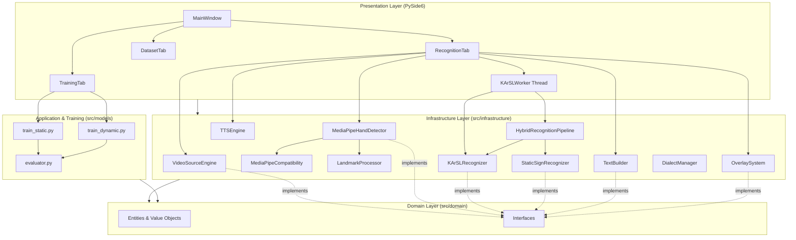
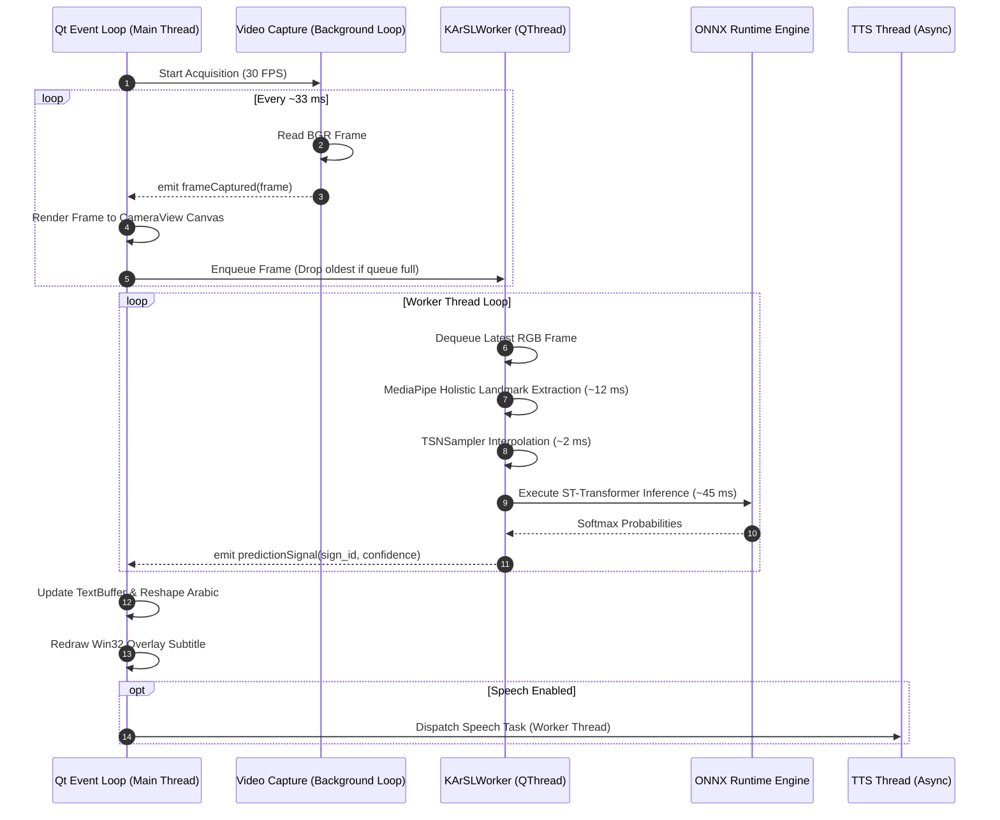

# Arabic Sign Language Recognition System — Software Architecture

> **System Designation:** ArSL Translation Overlay System  
> **Architecture Style:** Clean Architecture (Domain-Driven Design) + Hexagonal / Ports & Adapters  
> **Status:** Production / Verified Implementation  
> **Target Platform:** Windows 10 / 11 (64-bit) with cross-platform domain core  

---

## Table of Contents
1. [Architectural Overview & Design Principles](#1-architectural-overview--design-principles)
2. [Layered Architecture Breakdown](#2-layered-architecture-breakdown)
   - [2.1 Domain Layer (`src/domain/`)](#21-domain-layer-srcdomain)
   - [2.2 Infrastructure Layer (`src/infrastructure/`)](#22-infrastructure-layer-srcinfrastructure)
   - [2.3 Models & Training Layer (`src/models/`)](#23-models--training-layer-srcmodels)
   - [2.4 Presentation Layer (`src/presentation/`)](#24-presentation-layer-srcpresentation)
3. [System Component & Dependency Topology](#3-system-component--dependency-topology)
4. [Computer Vision & Keypoint Extraction Pipeline](#4-computer-vision--keypoint-extraction-pipeline)
   - [4.1 Video Source Adapters](#41-video-source-adapters)
   - [4.2 MediaPipe Tasks Compatibility Layer](#42-mediapipe-tasks-compatibility-layer)
   - [4.3 Monotonic Timestamp Synchronization](#43-monotonic-timestamp-synchronization)
5. [Dual Recognition Engine Pipeline](#5-dual-recognition-engine-pipeline)
   - [5.1 Foundation Model: KArSL-502 ST-Transformer](#51-foundation-model-karsl-502-st-transformer)
   - [5.2 Multimodal Feature Vector Topology (736 Dimensions)](#52-multimodal-feature-vector-topology-736-dimensions)
   - [5.3 Temporal Segment Network Sampling (`TSNSampler`)](#53-temporal-segment-network-sampling-tsnsampler)
   - [5.4 Custom Dialect Classification Engine (63 Dimensions)](#54-custom-dialect-classification-engine-63-dimensions)
   - [5.5 Hybrid Pipeline Router & Decision Fusion](#55-hybrid-pipeline-router--decision-fusion)
6. [NLP & Arabic Sentence Assembly](#6-nlp--arabic-sentence-assembly)
   - [6.1 Temporal Stabilization Buffer](#61-temporal-stabilization-buffer)
   - [6.2 Gesture Cooldown Management](#62-gesture-cooldown-management)
   - [6.3 Arabic Glyph Reshaping & BiDi Layout](#63-arabic-glyph-reshaping--bidi-layout)
7. [Transparent Subtitle Overlay Subsystem](#7-transparent-subtitle-overlay-subsystem)
   - [7.1 Win32 Native Layered Windows (Click-Through)](#71-win32-native-layered-windows-click-through)
   - [7.2 Qt Frameless Translucent Fallback](#72-qt-frameless-translucent-fallback)
8. [Concurrency, Threading & Performance Model](#8-concurrency-threading--performance-model)
   - [8.1 Worker Thread Lifecycle & Frame-Dropping Queues](#81-worker-thread-lifecycle--frame-dropping-queues)
   - [8.2 Latency Budgets & Throughput Metrics](#82-latency-budgets--throughput-metrics)
9. [Configuration & Dialect Management](#9-configuration--dialect-management)

---

## 1. Architectural Overview & Design Principles

The **Arabic Sign Language Recognition System** is organized according to **Clean Architecture** and **Ports & Adapters (Hexagonal Architecture)**. The primary objective is complete decoupling between business rules, machine learning algorithms, hardware-specific input adapters, and user interface frameworks.

```
                           +----------------------------------------+
                           |          Presentation Layer            |
                           |   (PySide6 Qt 6 GUI, HUD, Overlay)     |
                           +-------------------+--------------------+
                                               |
                                               v
                           +----------------------------------------+
                           |       Models & Application Layer       |
                           |  (Trainers, Evaluators, Data Splitter) |
                           +-------------------+--------------------+
                                               |
                                               v
                           +----------------------------------------+
                           |         Infrastructure Layer           |
                           |   (MediaPipe, ONNX, OpenCV, Win32)     |
                           +-------------------+--------------------+
                                               |
                                               v
                           +----------------------------------------+
                           |             Domain Layer               |
                           |   (Entities, Value Objects, Contracts) |
                           +----------------------------------------+
```

### Core Design Tenets
1. **Dependency Inversion:** Inner layers define abstract interfaces (`interfaces.py`). Outer layers implement these interfaces through concrete adapters (e.g., `MediaPipeHandDetector` implements `IHandDetector`).
2. **Decoupled Concurrency:** Heavy deep learning inference (45–65 ms) is isolated from the 30 FPS camera capture and the 60 FPS Qt UI event loop using dedicated background threads (`QThread`) with bounded, drop-oldest queues.
3. **Dual-Path Classification:** High-capacity general recognition (502 signs) is handled by a pretrained foundation ONNX model, while rapid, personalized dialect customization is handled by lightweight Scikit-Learn models.
4. **Deterministic Reproducibility:** Dataset splits, geometric normalization algorithms, and configuration hierarchies are strictly deterministic and version-controlled.

---

## 2. Layered Architecture Breakdown

```
src/
├── domain/                      # Pure Domain Layer (0 framework dependencies)
│   ├── entities.py              # Root entities & identification
│   ├── hand.py                  # Landmark, HandLandmarks, Handedness
│   ├── recognition.py           # RecognitionResult, Vocabulary, SignClass
│   ├── text.py                  # TextBuffer, Sentence, GestureCommand
│   ├── motion.py                # Trajectory, MotionFeatures, Velocity
│   ├── dialect.py               # Dialect metadata and vocabulary mapping
│   └── interfaces.py            # Abstract interfaces (IVideoSource, ISignRecognizer, etc.)
│
├── infrastructure/              # Infrastructure Layer (I/O, APIs, Hardware)
│   ├── hand_detection/          # MediaPipe Tasks Vision integration & normalization
│   │   ├── detector.py          # Concrete MediaPipeHandDetector
│   │   ├── mediapipe_compatibility.py # Vision Tasks adapter (.task bundles)
│   │   ├── renderer.py          # Skeletal overlay visualizer
│   │   └── utils.py             # LandmarkProcessor coordinate normalization
│   ├── recognition/             # Model inference implementations
│   │   ├── karsl_recognizer.py  # 736-dim ST-Transformer ONNX engine & TSNSampler
│   │   ├── hybrid_pipeline.py   # Recognition router & decision fusion
│   │   ├── static_recognizer.py # Scikit-Learn MLP / SVM / RF engine
│   │   ├── dynamic_recognizer.py# PyTorch LSTM / GRU / Transformer engine
│   │   └── word_recognizer.py   # Temporal windowed gesture classifier
│   ├── video_source_engine.py   # Pluggable capture adapters (Webcam, File, Screen, Win)
│   ├── overlay_system.py        # Win32 layered click-through & Qt overlay
│   ├── text_builder.py          # Arabic NLP sentence assembly, BiDi & reshaping
│   ├── dialect_manager.py       # Dialect pack discovery & filesystem loader
│   ├── analytics.py             # Telemetry, latency, and accuracy metrics
│   ├── optimization.py          # Memory optimization & queue bounding
│   └── audio/
│       └── tts_engine.py        # pyttsx3 offline Arabic TTS engine
│
├── models/                      # Modeling, Training & Evaluation Tools
│   ├── train_static.py          # Static model training pipeline (RF, SVM, MLP)
│   ├── train_dynamic.py         # Dynamic PyTorch training pipeline (LSTM, Transformer)
│   ├── evaluate.py              # Standalone evaluation CLI
│   └── evaluator.py             # ModelEvaluator & ModelRegistry
│
└── presentation/                # Presentation Layer (PySide6 Qt 6)
    ├── main_window.py           # MainWindow coordinator & service injection
    ├── dialogs/
    │   └── karsl_vocab_dialog.py# 502-sign searchable bilingual dictionary
    ├── styles/
    │   └── dark_theme.qss       # Dark glassmorphic Qt stylesheet
    ├── widgets/
    │   ├── camera_view.py       # OpenGL/QPainter video rendering canvas
    │   └── landmark_canvas.py   # Isolated skeletal vector canvas
    └── tabs/                    # 8 Application Studio Tabs
        ├── dashboard.py         # System telemetry & FPS
        ├── dataset.py           # Sample capture & dataset studio
        ├── training.py          # In-app training & hyperparameter tuning
        ├── recognition.py       # Live recognition viewport & KArSLWorker
        ├── overlay.py           # Subtitle customization controls
        ├── analytics.py         # Latency & historical metrics
        ├── settings.py          # Video resolution & threshold configs
        └── logs.py              # Live log stream & file exporter
```

---

## 3. System Component & Dependency Topology

The following Mermaid diagram maps the end-to-end component dependencies across all layers:



---

## 4. Computer Vision & Keypoint Extraction Pipeline

### 4.1 Video Source Adapters
Video acquisition is abstracted via `IVideoSource` using the Adapter pattern in `src/infrastructure/video_source_engine.py`:
- **`WebcamAdapter`:** Directly interfaces with `cv2.VideoCapture` using the Windows DirectShow backend (`cv2.CAP_DSHOW`), which minimizes hardware buffer bloat and achieves stable 30 FPS acquisition.
- **`FileAdapter`:** Reads offline `.mp4` or `.avi` files, supporting variable frame stepping and seamless looping for evaluation benchmarking.
- **`ScreenAdapter`:** Leverages `mss` for high-throughput desktop region grabbing across multi-monitor setups.
- **`WindowAdapter`:** Employs Windows GDI bindings (`win32gui`, `win32ui`, `win32con`) to capture client rectangles of specific third-party applications (e.g., Zoom, Teams) even when partially occluded.

### 4.2 MediaPipe Tasks Compatibility Layer
To insulate the codebase against breaking changes in MediaPipe (such as the deprecation of `mediapipe.python.solutions.hands`), the infrastructure layer implements `MediaPipeCompatibility` in `src/infrastructure/hand_detection/mediapipe_compatibility.py`.

It bundles Google's pre-compiled `.task` binary models located in `data/models/karsl/`:
1. `hand_landmarker.task`: 21 3D hand keypoints with left/right handedness classification.
2. `pose_landmarker.task`: 33 full-body skeletal landmarks (shoulders, elbows, wrists, hips).
3. `face_landmarker.task`: 468 dense 3D facial mesh points (irises, lips, contour).

### 4.3 Monotonic Timestamp Synchronization
MediaPipe's `LIVE_STREAM` operating mode enforces strictly increasing microsecond timestamps. Under variable webcam capture rates or dropped frames, identical timestamps cause immediate native runtime assertions. The compatibility layer implements a monotonic timestamp generator:

$$t_{\text{frame}} = \max\left(t_{\text{system\_microseconds}},\, t_{\text{last}} + 1\,\mu\text{s}\right)$$

This ensures that every frame dispatched to MediaPipe possesses a valid temporal index, preventing native C++ pipeline halts.

---

## 5. Dual Recognition Engine Pipeline

```
                                  [Input Frame]
                                        │
                                        ▼
                        [MediaPipe Tasks Vision Models]
                                        │
               ┌────────────────────────┴────────────────────────┐
               │                                                 │
       (Hand Detection)                               (Holistic Tracking)
               │                                                 │
      21 Hand Landmarks                              184 Multimodal Keypoints
               │                                                 │
               ▼                                                 ▼
     [LandmarkProcessor]                                 [TSNSampler]
     • Centering on Wrist                               • Buffer 15-50 frames
     • Scale Normalization                              • Interpolate to 50 timesteps
     • Dimension: (1, 63)                               • Dimension: (1, 50, 736)
               │                                                 │
               ▼                                                 ▼
      [Custom Dialect Engine]                           [KArSL-502 Engine]
     • Scikit-Learn (MLP/SVM/RF)                        • ONNX ST-Transformer
     • 3 Iraqi Dialect Classes                          • 502 Vocabulary Classes
               │                                                 │
               └────────────────────────┬────────────────────────┘
                                        │
                                        ▼
                           [Hybrid Pipeline Router]
                           • Priority: Custom vs KArSL
                           • Confidence Threshold Check (e.g. > 0.65)
                                        │
                                        ▼
                           [Stabilized Recognition Result]
```

### 5.1 Foundation Model: KArSL-502 ST-Transformer
- **Runtime Execution:** Hardware-accelerated inference via `onnxruntime.InferenceSession` loading `data/models/karsl/karsl_502.onnx` (file size: 7,330,073 bytes).
- **Network Architecture:** Spatio-Temporal Transformer (ST-Transformer). It alternates spatial self-attention blocks (learning geometric relationships between joints) with temporal multi-head attention blocks (learning the trajectory of signs over time).
- **Target Vocabulary:** 502 classes partitioned into:
  - Digits / Numbers: Indices 0 to 30.
  - Alphabet Letters: Indices 31 to 69.
  - Word Vocabulary: Indices 70 to 501.

### 5.2 Multimodal Feature Vector Topology (736 Dimensions)
The KArSL engine requires a 736-dimensional feature vector per timestep, derived from 184 keypoints with 4 coordinates each $(x, y, z, \text{visibility})$:

| Anatomical Group | Source Landmark IDs | Keypoints ($K$) | Dimensions ($K \times 4$) | Normalization Strategy |
| :--- | :--- | :--- | :--- | :--- |
| **Body Pose** | Shoulders (11,12), Elbows (13,14), Wrists (15,16) | 6 | 24 | Centered on Nose ($p_0$); normalized by inter-shoulder distance $\|\vec{p}_{11} - \vec{p}_{12}\|_2$. |
| **Facial Mesh** | Face oval, lips, eyes, and iris contours | 136 | 544 | Centered on Nose tip ($p_4$); normalized by inter-pupil distance. |
| **Right Hand** | 21 skeletal joints (wrist, thumb, index, mid, ring, pinky) | 21 | 84 | Centered on Right Wrist ($p_0$); normalized by palm span $\|\vec{p}_0 - \vec{p}_9\|_2$. |
| **Left Hand** | 21 skeletal joints (wrist, thumb, index, mid, ring, pinky) | 21 | 84 | Centered on Left Wrist ($p_0$); normalized by palm span $\|\vec{p}_0 - \vec{p}_9\|_2$. |
| **Total** | — | **184** | **736** | Formatted as `float32` array. |

If a hand or face is not detected in a frame, its corresponding slice is padded with zeros and a visibility flag of $0.0$.

### 5.3 Temporal Segment Network Sampling (`TSNSampler`)
Sign gestures vary in execution speed (typically lasting between 15 and 50 video frames). The system maintains a sliding window queue of recent multimodal frames.

When inference is triggered:
1. If the buffer contains $N < 15$ frames, inference is bypassed (gesture segment too short).
2. If $15 \le N \le 50$, `TSNSampler` divides the sequence into 50 uniform segments and performs linear interpolation across the temporal axis to produce an exact tensor of shape:
   $$\mathbf{X}_{\text{input}} \in \mathbb{R}^{1 \times 50 \times 736}$$
3. The tensor is passed to ONNX Runtime, generating class logits that are converted to probabilities via Softmax:
   $$P(\text{class}_k) = \frac{e^{z_k}}{\sum_{j=1}^{502} e^{z_j}}$$

### 5.4 Custom Dialect Classification Engine (63 Dimensions)
For rapid customization without heavy transformer training, the system includes `StaticSignRecognizer`:
- **Input Dimension:** 21 hand landmarks $\times 3 \text{ spatial coordinates } (x, y, z) = 63 \text{ features}$.
- **Preprocessing via `LandmarkProcessor`:**
  1. *Translation Invariance:* Wrist joint $\vec{p}_0 = (x_0, y_0, z_0)$ is translated to origin $(0, 0, 0)$:
     $$\vec{p}'_i = \vec{p}_i - \vec{p}_0 \quad \forall i \in [0, 20]$$
  2. *Scale Invariance:* Normalized by the maximum bounding radius $R = \max_i \|\vec{p}'_i\|_2$:
     $$\vec{p}''_i = \frac{\vec{p}'_i}{R + \epsilon}$$
- **Model Checkpoints:** Scikit-learn `MLPClassifier` (`static_model.pkl`), `SVC` (`static_svm.pkl`), or `RandomForestClassifier`.
- **Dialect Separation:** Weights and vocabularies are stored separately per dialect in `data/models/<dialect>/`.

### 5.5 Hybrid Pipeline Router & Decision Fusion
Implemented in `src/infrastructure/recognition/hybrid_pipeline.py`, the router determines which model prediction to surface based on user configuration and confidence scoring:
1. **Engine Selection Mode:** User can explicitly enforce `KArSL-502` mode or `Custom Dialect` mode.
2. **Hybrid Arbitration:** When both engines are active, the custom dialect model is prioritized for registered dialect signs if its confidence exceeds the threshold $\theta_{\text{custom}} = 0.70$. Otherwise, the system falls back to the KArSL-502 foundation model if $\theta_{\text{karsl}} \ge 0.60$.
3. If no classifier exceeds its threshold, the prediction is discarded as background noise or transition motion.

---

## 6. NLP & Arabic Sentence Assembly

Recognizing individual signs is insufficient for communication; signs must be assembled into intelligible sentences without repeated character bursts or jitter. This is handled by `TextBuilder` in `src/infrastructure/text_builder.py`.

```
Raw Predictions:  [السلام_عليكم] ──> [السلام_عليكم] ──> [السلام_عليكم]
                            │
                            ▼
              [Temporal Stabilization Filter]
              • Consecutive matches N = 3
              • Confirmed sign: "السلام عليكم"
                            │
                            ▼
                  [Cooldown Interlock]
              • Ignore identical signs for 1.5s
                            │
                            ▼
                [Sentence Buffer Assembly]
              • Current sentence: "السلام عليكم" + "..."
                            │
                            ▼
              [Arabic Reshaping & BiDi Layout]
              • arabic_reshaper: Cursive glyph joining
              • python_bidi: Right-to-Left reordering
                            │
                            ▼
              [Final Visual Arabic String]
```

### 6.1 Temporal Stabilization Buffer
Raw frame-by-frame predictions often flicker during gesture entry and exit phases. The `TextBuilder` implements a stateful stabilization queue:
- A recognized word is only committed to the sentence buffer if it is predicted identically for $N$ consecutive evaluations (configurable, default $N = 3$).
- This simple temporal filter suppresses false-positive spikes during transitional arm movements.

### 6.2 Gesture Cooldown Management
Signers naturally hold a gesture in the air for 1–2 seconds. Without suppression, a 30 FPS camera would register the same sign 30 to 60 times.
- The `CooldownManager` timestamps committed words.
- If the newly recognized sign matches the immediately preceding sign, it is suppressed until a configurable cooldown interval (e.g., $1.5\text{ seconds}$) has elapsed or an intermediate "neutral/idle" pose is detected.

### 6.3 Arabic Glyph Reshaping & BiDi Layout
Standard graphic rendering engines treat text as Left-to-Right (LTR) and render Arabic characters as disconnected, isolated glyphs.
1. **Shaping (`arabic-reshaper`):** Converts isolated Arabic unicode characters into context-appropriate cursive glyphs (initial, medial, final, or standalone):
   $$\text{Reshape}(\text{"ا ل س ل ا م"}) \longrightarrow \text{"السـلام"}$$
2. **Bidirectional Layout (`python-bidi`):** Applies the Unicode Bidirectional Algorithm (UBA) to ensure Arabic phrases render correctly from Right-to-Left (RTL), even when mixed with Latin numbers or punctuation:
   $$\text{BiDi}(\text{"السـلام"}) \longrightarrow \text{Renderable Visual String}$$

---

## 7. Transparent Subtitle Overlay Subsystem

The application provides a floating subtitle window capable of displaying live translations on top of other running desktop applications (e.g., Zoom meetings, media players, browsers).

```
┌─────────────────────────────────────────────────────────────┐
│ Zoom / Video Conference Meeting Window                      │
│                                                             │
│   ┌─────────────────────────────────────────────────────┐   │
│   │ [Live Speaker Video Feed]                           │   │
│   │                                                     │   │
│   │                                                     │   │
│   │   ┌─────────────────────────────────────────────┐   │   │
│   │   │ ArSL Click-Through Subtitle Overlay (Win32) │   │   │
│   │   │ [السلام عليكم ورحمة الله وبركاته]           │   │   │
│   │   └─────────────────────────────────────────────┘   │   │
│   │                                                     │   │
│   └─────────────────────────────────────────────────────┘   │
│                                                             │
│   [Mute] [Stop Video] [Share Screen] [Leave Meeting]        │
└─────────────────────────────────────────────────────────────┘
  ▲
  │ Mouse clicks pass directly through subtitle text to meeting controls!
```

### 7.1 Win32 Native Layered Windows (Click-Through)
Implemented in `src/infrastructure/overlay_system.py`, native Windows integration is achieved via `ctypes.windll.user32`:
1. **Layered Style:** Applies `WS_EX_LAYERED (0x00080000)` to allow per-pixel alpha channel transparency.
2. **Click-Through:** Applies `WS_EX_TRANSPARENT (0x00000020)`, which directs the Windows OS to ignore mouse clicks and pass them to whichever window lies beneath the overlay.
3. **Always-On-Top:** Applies `WS_EX_TOPMOST (0x00000008)` to prevent the subtitle from being obscured when clicking active background windows.

### 7.2 Qt Frameless Translucent Fallback
On non-Windows platforms or when hardware click-through is disabled in preferences:
- The overlay initializes as a `QWidget` with flags:
  `Qt.FramelessWindowHint | Qt.WindowStaysOnTopHint | Qt.SubWindow`
- Attributes set: `Qt.WA_TranslucentBackground` and `Qt.WA_ShowWithoutActivating`.
- Renders high-contrast white Arabic typography with black alpha borders for optimal legibility over any background.

---

## 8. Concurrency, Threading & Performance Model

Sign language recognition requires orchestrating real-time I/O, heavy matrix multiplication, and responsive GUI rendering.



### 8.1 Worker Thread Lifecycle & Frame-Dropping Queues
- **Main GUI Thread:** Manages the PySide6 Qt event loop, user interactions, video canvas rendering, and HUD overlays. It is strictly forbidden from executing blocking operations.
- **`KArSLWorker` Thread:** Runs as an independent `QThread` (`src/presentation/tabs/recognition.py`).
  - Frames are dispatched to the worker via a bounded queue of size $M = 2$.
  - **Queue-Dropping Strategy:** If the worker is busy executing ONNX inference and a new frame arrives, the oldest frame is discarded immediately. This decouples the 30 FPS camera stream from the ~15–20 FPS inference loop, preventing latency accumulation and memory expansion.
- **Audio TTS Thread:** Speech generation via `pyttsx3` is handled by an asynchronous daemon thread to prevent voice synthesis from stalling frame rendering.

### 8.2 Latency Budgets & Throughput Metrics
The end-to-end latency budget from physical gesture to subtitle display is summarized below:

| Stage | Operation | Verified Latency | Hardware Target |
| :--- | :--- | :--- | :--- |
| **Stage 1** | DirectShow Frame Acquisition | $5 - 10\text{ ms}$ | USB 2.0 / 3.0 Webcam |
| **Stage 2** | MediaPipe Keypoint Extraction (Hands+Pose+Face) | $12 - 18\text{ ms}$ | Multi-core CPU (AVX2 enabled) |
| **Stage 3** | TSN Sampling & Normalization | $1 - 3\text{ ms}$ | NumPy vectorized float32 |
| **Stage 4** | ONNX ST-Transformer Inference | $45 - 65\text{ ms}$ | ONNX Runtime (CPU) |
| **Stage 5** | NLP Stabilization & Arabic Reshaping | $< 1\text{ ms}$ | Native Python |
| **Stage 6** | Win32 Transparent GDI Subtitle Update | $2 - 4\text{ ms}$ | Windows Desktop Window Manager |
| **Total** | **End-to-End Latency** | **$66 - 101\text{ ms}$** | Real-time interactive ($< 150\text{ ms}$) |

---

## 9. Configuration & Dialect Management

System behavior is externally controlled through a hierarchical YAML architecture:
- `config/default.yaml`: Immutable system baseline (default camera index, 640x480 resolution, 30 FPS target, MediaPipe confidence thresholds, text stabilization counts).
- `config/logging.yaml`: Handlers, formatting, and file-rotation limits for `logs/app.log`.
- `config/user.yaml`: Runtime user overrides (active dialect, selected video adapter, overlay opacity, font scale, audio TTS toggle).

### Dialect Pack Hierarchy
The `DialectManager` discovers and registers dialects dynamically from the filesystem:
```
data/models/
├── karsl/                   # Foundation General Arabic Pack (502 signs)
│   ├── karsl_502.onnx
│   └── labels.json
├── iraqi/                   # Iraqi Dialect Pack
│   ├── static_model.pkl
│   ├── static_svm.pkl
│   ├── classes.json
│   └── vocabulary.json
├── saudi/                   # Saudi Dialect Pack (Scaffolding)
└── egyptian/                # Egyptian Dialect Pack (Scaffolding)
```
Each dialect folder maintains its own isolated vocabulary mappings, model checkpoints, and evaluation reports, allowing regional sign packs to be swapped at runtime without modifying application source code.
