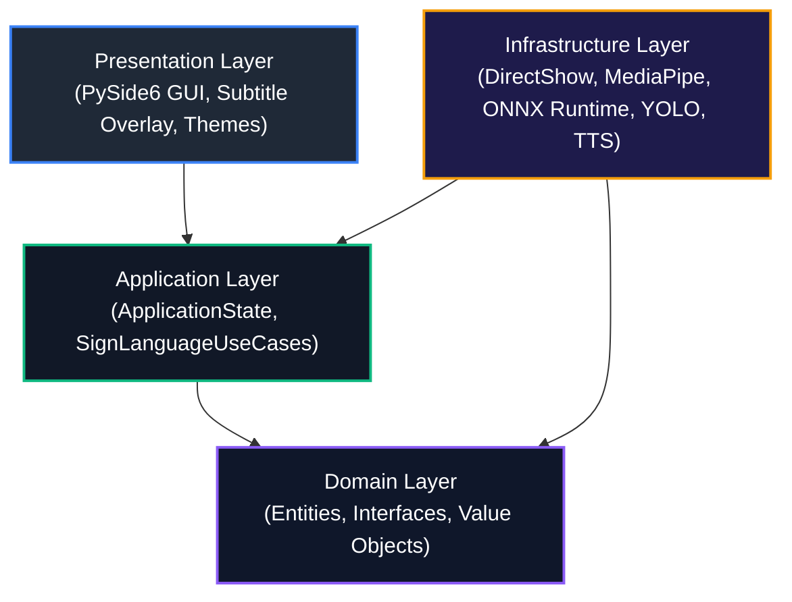
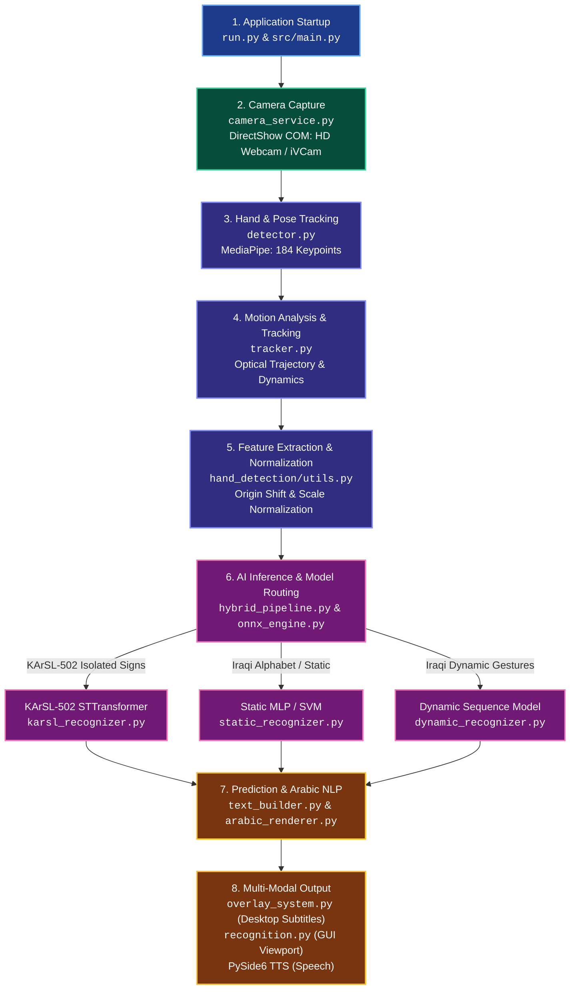

# Project File Guide: Vision-Based Sign Language Recognition

This document serves as an exhaustive, academic reference guide for the **Vision-Based Sign Language Recognition System**. It is structured to help university professors, examination committees, and students understand the architectural role, runtime purpose, and inter-module dependencies of every file in the repository.

---

## 1. Clean Architecture Overview

The system strictly adheres to **Clean Architecture** (Robert C. Martin), decoupling the high-level domain rules from frameworks, user interfaces, and external hardware APIs:



- **Domain Layer (`src/domain/`)**: Pure business logic, core entities, and abstract interfaces. Zero external dependencies.
- **Application Layer (`src/application/`)**: Use cases, workflow orchestrations, and reactive application state.
- **Infrastructure Layer (`src/infrastructure/`)**: Concrete implementations of domain interfaces: hardware cameras (DirectShow), neural network engines (ONNX Runtime), computer vision (MediaPipe, YOLOv8), text formatting, and dataset management.
- **Presentation Layer (`src/presentation/`)**: PySide6 graphical interface, live recognition viewport, floating overlay window, and theme management.

---

## 2. End-to-End Real-Time Execution Pipeline

The diagram below illustrates the exact execution path from camera frame ingestion to multi-modal output:



### Detailed Pipeline Stages & File Involvement

1. **Application Start (`run.py`, `src/main.py`)**:
   - Initializes logging, reads configuration (`config/default.yaml`), and instantiates `QApplication`.
   - Injects dependencies into `SignLanguageUseCases` and mounts `MainWindow`.
2. **Camera Ingestion (`src/infrastructure/camera_service.py`)**:
   - Native Windows DirectShow COM enumerates hardware devices (`HD Webcam`, `e2eSoft iVCam`).
   - `OpenCVCameraService` opens the selected device index or video stream with asynchronous zero-leak switching.
3. **Computer Vision & Landmark Tracking (`src/infrastructure/hand_detection/detector.py`)**:
   - MediaPipe extracts 21 3D hand landmarks per hand, 33 body pose landmarks, and 468 face mesh points.
   - Total of 184 normalized coordinates are structured for classification.
4. **Motion Tracking (`src/infrastructure/motion_tracking/tracker.py`)**:
   - Calculates optical velocity, acceleration, and movement trajectories for dynamic gesture boundary detection.
5. **Feature Extraction (`src/infrastructure/hand_detection/utils.py`)**:
   - Normalizes coordinates relative to the wrist/palm root, eliminating spatial scale and translation drift.
6. **AI Model Inference (`src/infrastructure/recognition/hybrid_pipeline.py`)**:
   - Evaluates sign velocity: low motion routes to `StaticSignRecognizer` (MLP/SVM); high continuous motion routes to `DynamicSignRecognizer` (BiLSTM) or `KArSLRecognizer` (ONNX Runtime).
7. **Arabic Natural Language Formatting (`src/infrastructure/text_builder.py`, `arabic_renderer.py`)**:
   - Manages state machine for character concatenation, backspace, whitespace insertion, and debounce.
   - Reshapes Arabic letters and applies Unicode Bidirectional Algorithm (BiDi) for correct right-to-left presentation.
8. **Multi-Modal Presentation (`src/infrastructure/overlay_system.py`, `src/presentation/tabs/recognition.py`)**:
   - Displays live skeletal bounding boxes and Arabic annotations on the main camera feed.
   - Projects transparent floating subtitles on top of other desktop windows for real-time video call accessibility.

---

## 3. Directory Structure & File Catalog

```
Vision-Based-Sign-Language-Recognition/
├── .github/                      # CI/CD automation workflows
├── config/                       # Application & logging YAML configuration
├── data/                         # Trained models, manifests, and dataset recordings
├── docs/                         # Technical specifications and guides
├── external/                     # Third-party attribution & reference upstream
├── scripts/                      # Setup scripts and latency benchmarking
├── src/                          # Clean Architecture source code
│   ├── application/              # State & use case layer
│   ├── domain/                   # Entities & interfaces
│   ├── infrastructure/           # Concrete adapters, CV, AI, & drivers
│   ├── models/                   # Training & offline evaluation routines
│   └── presentation/             # PySide6 desktop GUI & custom widgets
└── tests/                        # Comprehensive automated unit & integration tests
```

---

### 3.1. Project Root

| File Name | Layer | Purpose & Functionality | Interacting Modules |
| :--- | :--- | :--- | :--- |
| `run.py` | Launcher | Universal entry point. Resolves project root, verifies `.venv`, and starts application. | `src.main`, `sitecustomize.py` |
| `run` | Launcher | Posix/bash extensionless launcher trampoline for `python run`. | `run.py` |
| `sitecustomize.py` | Launcher Hook | Scoped Python startup hook allowing `python run` / `python run.py` from any nested directory. | Python interpreter, `run.py` |
| `requirements.txt` | Configuration | Pinned production dependencies (PySide6, OpenCV, MediaPipe, ONNX Runtime, Ultralytics). | `pip`, CI, PyInstaller |
| `pyproject.toml` | Build / Tools | Project metadata, build configurations, Ruff linter settings, and pytest arguments. | `pip`, `ruff`, `pytest` |
| `setup.py` | Build / Packaging | Standard setuptools package configuration for editable installations (`pip install -e .`). | `pyproject.toml` |
| `Makefile` | Build Automation | Cross-platform automation commands (`make run`, `make test`, `make lint`, `make build-exe`). | Terminal, PyInstaller |
| `Dockerfile` | Containerization | Docker container configuration for headless Linux testing and server builds. | Docker engine |
| `docker-compose.yml` | Containerization | Multi-service orchestration configuration for containerized deployment. | Docker Compose |
| `installer.nsi` | Packaging | Nullsoft Scriptable Install System (NSIS) Windows installer compilation script. | NSIS Compiler |
| `README.md` | Documentation | Primary project landing page, hardware requirements, features, and setup instructions. | GitHub |
| `ARCHITECTURE.md` | Documentation | Detailed architectural specification describing Clean Architecture design patterns. | Academic Reviewers |
| `LICENSE` | Legal | MIT Open Source License preserving author rights and distribution permissions. | All components |
| `.gitignore` | Version Control | Specifies intentionally untracked files (virtual environments, caches, temporary logs). | Git |
| `.gitattributes` | Version Control | Configures Git line endings, text handling, and large binary storage filters. | Git |
| `.env.example` | Configuration | Template for optional environment variables (camera index overrides, debug flags). | `ConfigManager` |

---

### 3.2. Configuration Layer (`config/`)

| File Name | Layer | Purpose & Functionality | Interacting Modules |
| :--- | :--- | :--- | :--- |
| `config/default.yaml` | Configuration | Base system defaults: target FPS (30), frame dimensions (640x480), confidence thresholds, overlay styles. | `src/infrastructure/config_manager.py` |
| `config/logging.yaml` | Configuration | Python logging configuration (file rotating handlers, console formatters, severity levels). | `src/main.py` |
| `config/user.yaml` | Configuration | Runtime user overrides (persisted camera selection, customized subtitle colors, font sizes). | `ConfigManager`, Settings Tab |

---

### 3.3. Application Domain Layer (`src/domain/`)

The pure domain layer contains zero third-party dependencies, guaranteeing maximum testability and stability.

| File Name | Layer | Purpose & Functionality | Interacting Modules |
| :--- | :--- | :--- | :--- |
| `src/domain/entities.py` | Domain | Core domain entities: `CameraDevice`, `RecognitionMode`, `BoundingBox`, and `FrameMetadata`. | `camera_service.py`, `use_cases.py` |
| `src/domain/interfaces.py` | Domain | Abstract contracts: `CameraService`, `SignRecognizer`, `InferenceEngine`, and `ConfigRepository`. | `infrastructure/*`, `use_cases.py` |
| `src/domain/hand.py` | Domain | Hand representation: `Hand`, `HandLandmark`, `Handedness` (Left/Right), and landmark coordinates. | `detector.py`, `recognizer/*` |
| `src/domain/motion.py` | Domain | Spatial dynamics: `Position2D`, `Velocity2D`, `Acceleration2D`, and `HandMotionTrack`. | `tracker.py`, `hybrid_pipeline.py` |
| `src/domain/recognition.py` | Domain | Recognition outputs: `SignPrediction`, `PredictionConfidence`, `GestureCategory` (Static/Dynamic). | `hybrid_pipeline.py`, `text_builder.py` |
| `src/domain/text.py` | Domain | Sentence synthesis: `ArabicCharacter`, `ArabicWord`, `SentenceState`, and editing commands. | `text_builder.py`, `arabic_renderer.py` |
| `src/domain/dialect.py` | Domain | Sign language dialects: `Dialect`, `DialectMetadata`, class inventories, and vocabulary bindings. | `dialect_manager.py` |

---

### 3.4. Application Core Layer (`src/application/`)

| File Name | Layer | Purpose & Functionality | Interacting Modules |
| :--- | :--- | :--- | :--- |
| `src/application/state.py` | Application | `ApplicationState` — reactive observable state managing current camera, active dialect, and FPS. | `MainWindow`, all GUI tabs |
| `src/application/use_cases.py` | Application | `SignLanguageUseCases` — orchestrates camera switching, gesture prediction, sentence construction, and TTS. | `state.py`, domain interfaces, GUI |

---

### 3.5. Infrastructure Layer (`src/infrastructure/`)

#### 3.5.1. Camera & Hardware Integration
| File Name | Layer | Purpose & Functionality | Interacting Modules |
| :--- | :--- | :--- | :--- |
| `src/infrastructure/camera_service.py` | Camera / Driver | Native Windows DirectShow COM enumerator & `OpenCVCameraService`. Resolves concurrent iVCam & HD Webcam access. | `entities.py`, `use_cases.py`, GUI |
| `src/infrastructure/camera_diagnostics.py` | Diagnostics | Diagnostic utility testing DirectShow bindings, listing hardware IDs, and logging to `logs/`. | `camera_service.py`, `recognition.py` |
| `src/infrastructure/video_source_engine.py` | Camera / Driver | Video capture worker thread with queue decoupling, preventing GUI freezing during camera IO. | `camera_service.py`, `recognition.py` |

#### 3.5.2. Computer Vision & Landmark Detection
| File Name | Layer | Purpose & Functionality | Interacting Modules |
| :--- | :--- | :--- | :--- |
| `src/infrastructure/hand_detection/detector.py` | Vision / AI | `HandDetector` wrapping MediaPipe Hands for high-precision 21-keypoint extraction per hand. | `domain/hand.py`, `renderer.py` |
| `src/infrastructure/hand_detection/mediapipe_compatibility.py` | Vision / Bridge | Compatibility layer ensuring seamless operation across differing protobuf and MediaPipe releases. | `detector.py` |
| `src/infrastructure/hand_detection/renderer.py` | Vision / GUI | Draws hand skeletons, confidence pills, bounding boxes, and landmark connections onto OpenCV frames. | `recognition.py`, `dataset.py` |
| `src/infrastructure/hand_detection/utils.py` | Vision / Math | Mathematical utility for wrist-relative coordinate normalization, scale invariance, and bounding boxes. | `detector.py`, `recognizer/*` |

#### 3.5.3. Motion Tracking & Spatial Dynamics
| File Name | Layer | Purpose & Functionality | Interacting Modules |
| :--- | :--- | :--- | :--- |
| `src/infrastructure/motion_tracking/tracker.py` | Vision / Physics | `MotionTracker` computing velocity vectors and optical trajectory curves to segment dynamic signs. | `hybrid_pipeline.py`, `domain/motion.py` |

#### 3.5.4. Machine Learning Inference & Recognizers
| File Name | Layer | Purpose & Functionality | Interacting Modules |
| :--- | :--- | :--- | :--- |
| `src/infrastructure/inference/base.py` | AI / Abstraction | Abstract Base Class `BaseInferenceEngine` defining `load()`, `predict()`, and `warmup()`. | `onnx_engine.py` |
| `src/infrastructure/inference/onnx_engine.py` | AI / Engine | `ONNXInferenceEngine` running hardware-accelerated ONNX Runtime execution providers (CPU/DirectML/CUDA). | `karsl_recognizer.py`, `model_exporter.py` |
| `src/infrastructure/model_exporter.py` | AI / MLOps | Utility converting PyTorch (`.pt`, `.pth`) models into optimized ONNX runtime graphs. | `src/models/train_*.py` |
| `src/infrastructure/recognition/hybrid_pipeline.py` | AI / Pipeline | `HybridSignPipeline` coordinating velocity routing, multi-model arbitration, and confidence gating. | All recognizers, `use_cases.py` |
| `src/infrastructure/recognition/karsl_recognizer.py` | AI / Model | Recognizer for the 502-sign KArSL benchmark utilizing Spatio-Temporal Transformer ONNX model. | `onnx_engine.py`, `labels.json` |
| `src/infrastructure/recognition/static_recognizer.py` | AI / Model | Single-frame classifier (MLP/SVM) for static alphabet hand signs in the Iraqi dialect. | `static_mlp.pkl`, `static_svm.pkl` |
| `src/infrastructure/recognition/dynamic_recognizer.py` | AI / Model | Temporal sequence recognizer (BiLSTM) for continuous motion gesture phrases. | `data/models/iraqi/` |
| `src/infrastructure/recognition/word_recognizer.py` | AI / NLP | Disambiguation engine matching model class predictions against vocabulary dictionaries. | `dialect_manager.py`, `vocabulary.json` |

#### 3.5.5. NLP, Arabic Rendering, & Multi-Modal Output
| File Name | Layer | Purpose & Functionality | Interacting Modules |
| :--- | :--- | :--- | :--- |
| `src/infrastructure/text_builder.py` | NLP / State | State machine accumulating recognized signs into words and sentences with backspace/clear. | `hybrid_pipeline.py`, `arabic_renderer.py` |
| `src/infrastructure/arabic_renderer.py` | NLP / Rendering | Reshapes Arabic letters and executes Bidirectional Algorithm (BiDi) for RTL typography. | `text_builder.py`, `overlay_system.py` |
| `src/infrastructure/dialect_manager.py` | Domain Services | Manages dialect switching, vocabulary loading, and active dialect metadata. | `use_cases.py`, `classes.json` |
| `src/infrastructure/overlay_system.py` | GUI / Overlay | Frameless, transparent, always-on-top subtitle overlay window for desktop presentations. | `use_cases.py`, `overlay.py` tab |
| `src/infrastructure/analytics.py` | Telemetry | Real-time session analytics: frame rate tracking, latency budgeting, and recognition counters. | `analytics.py` tab |
| `src/infrastructure/optimization.py` | System / Perf | Adaptive FPS budgeting, latency profiling, and dynamic thread pool management. | `video_source_engine.py` |
| `src/infrastructure/config_manager.py` | Configuration | YAML-based configuration manager reading, writing, and validating settings. | `config/*.yaml` |
| `src/infrastructure/config_repository.py` | Configuration | Clean Architecture JSON implementation of the domain `ConfigRepository` interface. | `domain/interfaces.py` |

#### 3.5.6. Dataset Engineering
| File Name | Layer | Purpose & Functionality | Interacting Modules |
| :--- | :--- | :--- | :--- |
| `src/infrastructure/dataset/collector.py` | Dataset | Records live MediaPipe landmark streams to `.npy` and metadata `.json` for new signs. | `dataset.py` tab |
| `src/infrastructure/dataset/augmenter.py` | Dataset | Spatial and temporal augmentation: rotation, jitter, scaling, and frame interpolation. | `train_*.py` |
| `src/infrastructure/dataset/organizer.py` | Dataset | Scans dataset directories, indexes classes, checks balance, and calculates metrics. | `Makefile`, `dataset.py` tab |
| `src/infrastructure/dataset/splitter.py` | Dataset | Deterministic train/validation/test split manager with SHA-256 integrity verification. | `train_*.py` |
| `src/infrastructure/dataset/validator.py` | Dataset | Validates landmark coordinate ranges, checks for NaN/inf values, and confirms frame lengths. | `dataset.py` tab |
| `src/infrastructure/dataset/versioning.py` | Dataset | Generates cryptographic manifests of dataset samples to guarantee scientific reproducibility. | Dataset pipeline |

---

### 3.6. Presentation Layer (`src/presentation/`)

| File Name | Layer | Purpose & Functionality | Interacting Modules |
| :--- | :--- | :--- | :--- |
| `src/main.py` | GUI / Bootstrap | Application entry point: initializes PySide6, loads styles, wires services, and launches GUI. | All presentation & application layers |
| `src/presentation/main_window.py` | GUI Shell | Main desktop window: modern tab container, status bar, and system tray integration. | All tabs, `use_cases.py` |
| `src/presentation/theme.py` | GUI Styling | Dark theme design system: color palette, QSS stylesheets, and consistent typography. | `MainWindow`, widgets |
| `src/presentation/widgets.py` | GUI Widgets | Custom reusable UI controls: metric cards, status badges, confidence meters, and action buttons. | All tabs |
| `src/presentation/dialogs/karsl_vocab_dialog.py` | GUI Dialog | Searchable dialog displaying all 502 KArSL signs, English/Arabic glosses, and categories. | `recognition.py` tab |
| `src/presentation/tabs/recognition.py` | GUI Tab | Core recognition viewport: DirectShow camera selector (`HD Webcam`, `e2eSoft iVCam`), video preview, skeletal landmark overlay, large Arabic word display, sentence builder, and speech controls. | `use_cases.py`, `video_source_engine.py` |
| `src/presentation/tabs/dataset.py` | GUI Tab | Interactive recording studio for collecting new sign samples with live countdowns and verification. | `collector.py`, `validator.py` |
| `src/presentation/tabs/training.py` | GUI Tab | Model training center: triggers local model retraining, displays loss curves and training metrics. | `train_*.py` |
| `src/presentation/tabs/settings.py` | GUI Tab | Unified configuration center: camera hardware, sign recognition models, desktop subtitle overlay, and general preferences. | `ConfigManager` |

---

### 3.7. Offline Training & Evaluation Layer (`src/models/`)

| File Name | Layer | Purpose & Functionality | Interacting Modules |
| :--- | :--- | :--- | :--- |
| `src/models/train_static.py` | Training | Trains static sign classifier (MLP / SVM) on landmark datasets; outputs serialized `.pkl` models. | `augmenter.py`, `evaluator.py` |
| `src/models/train_dynamic.py` | Training | Trains sequence models (BiLSTM) for continuous dynamic gestures; outputs model checkpoints. | `splitter.py`, `evaluator.py` |
| `src/models/evaluator.py` | Evaluation | Computes classification metrics: accuracy, precision, recall, F1-score, and confusion matrix. | `evaluate.py`, `train_*.py` |
| `src/models/evaluate.py` | Evaluation | CLI evaluation utility generating detailed performance reports on test splits. | `evaluator.py` |

---

### 3.8. Data Assets Layer (`data/`)

| File Name / Folder | Purpose & Functionality |
| :--- | :--- |
| `data/models/manifest.json` | Model catalog linking model identifiers, paths, performance metrics, and version numbers. |
| `data/models/karsl/karsl_502.onnx` | Pretrained Spatio-Temporal Transformer ONNX model covering 502 continuous Arabic signs. |
| `data/models/karsl/labels.json` | Gloss index mapping numeric class IDs to Arabic words and English translations. |
| `data/models/karsl/*.task` | MediaPipe task bundle files for hand, face, and pose landmarkers. |
| `data/models/iraqi/static_model.pkl` | Pretrained Multi-Layer Perceptron (MLP) for Iraqi dialect alphabet signs. |
| `data/models/iraqi/static_svm.pkl` | Pretrained Support Vector Machine (SVM) classifier for Iraqi static gestures. |
| `data/models/iraqi/classes.json` | List of supported sign classes in the Iraqi dialect. |
| `data/models/iraqi/vocabulary.json` | Domain vocabulary linking gestures to contextual sentences. |
| `data/datasets/` | 356 recorded sample files (`landmarks.npy` and `metadata.json`) for Iraqi dialect signs. |

---

### 3.9. Developer Utilities & Scripts (`scripts/`)

| File Name | Layer | Purpose & Functionality |
| :--- | :--- | :--- |
| `scripts/benchmark_inference.py` | Utilities | Measures inference latency (mean, median, p90, p99) across ONNX, PyTorch, and scikit-learn models. |
| `scripts/setup_launcher.py` | Utilities | Cross-platform launcher setup script that registers user environment hooks. |
| `scripts/setup_launcher.ps1` | Utilities | PowerShell helper script automating Windows launcher environment configuration. |

---

### 3.10. Automated Test Suite (`tests/`)

The repository includes a comprehensive automated test suite consisting of **234 tests** providing continuous validation across all layers:

| Test File | Target Module Tested | Scope & Validated Behaviors |
| :--- | :--- | :--- |
| `tests/test_camera_dropdown_and_switching.py` | `camera_service.py`, `recognition.py` | DirectShow device enumeration, concurrent iVCam & HD Webcam detection, async camera switching, and landmark tracking. |
| `tests/test_camera_stream_and_yolo.py` | `video_source_engine.py` | Video thread capture, FPS throttling, frame queue decoupling, and camera stream validation. |
| `tests/test_hand_detection.py` | `detector.py`, `renderer.py`, `utils.py` | MediaPipe keypoint detection, coordinate normalization, bounding box calculations, skeleton rendering. |
| `tests/test_karsl.py` | `karsl_recognizer.py`, `vocab_dialog.py` | 502-class ONNX inference, label mapping, vocabulary dialog search, and confidence thresholding. |
| `tests/test_hybrid_pipeline.py` | `hybrid_pipeline.py` | Dynamic vs static routing based on motion velocity, combined mode arbitration, confidence gating. |
| `tests/test_recognition.py` | `static_recognizer.py`, `dynamic_recognizer.py` | MLP and SVM prediction, batch landmark classification, softmax probability distribution. |
| `tests/test_text_builder.py` | `text_builder.py`, `arabic_renderer.py` | Character appending, word formation, space/backspace commands, Arabic reshaping, and BiDi rendering. |
| `tests/test_overlay.py` | `overlay_system.py` | Desktop subtitle window creation, transparency settings, click-through behavior, font resizing. |
| `tests/test_motion_tracking.py` | `tracker.py` | Optical trajectory tracking, velocity and acceleration math, movement history buffering. |
| `tests/test_dialect_manager.py` | `dialect_manager.py` | Dialect switching (Iraqi vs KArSL), vocabulary retrieval, class dictionary parsing. |
| `tests/test_dataset.py` | `collector.py`, `organizer.py`, `validator.py` | Live sample recording, landmark array persistence, class balancing metrics, data integrity checks. |
| `tests/test_analytics.py` | `analytics.py` | Session metric counters, frame time calculations, latency budget monitoring. |
| `tests/integration/test_pipeline_integration.py` | Full Pipeline | End-to-end integration: synthetic frame → hand detector → hybrid pipeline → text builder. |
| `tests/integration/test_config_integration.py` | `config_manager.py` | YAML hierarchical loading, default fallbacks, environment variable overrides. |
| `tests/integration/test_data_augmentation.py` | `augmenter.py`, `splitter.py` | Landmark rotation, noise injection, scale variation, train/val/test split determinism. |
| `tests/integration/test_model_export.py` | `model_exporter.py` | Model checkpoint export to ONNX graph format, ONNX graph validation. |
| `tests/integration/test_performance_benchmarks.py` | `optimization.py`, `onnx_engine.py` | Latency benchmarking, thread pool stress testing, memory leak verification. |

---

### 3.11. Academic Documentation (`docs/`)

| File Name | Purpose |
| :--- | :--- |
| `docs/API.md` | Complete programmatic API reference for all services, adapters, and domain interfaces. |
| `docs/component-design.md` | UML-style component diagrams, class hierarchies, and sequence interactions. |
| `docs/technical-specification.md` | Hardware specifications, mathematical formulas, network architectures, and latency budgets. |
| `docs/USER_GUIDE.md` | End-user manual explaining camera setup, GUI navigation, subtitle customization, and model training. |
| `docs/TESTING.md` | Testing methodology, test execution instructions, coverage targets, and headless CI notes. |
| `docs/DEPLOYMENT.md` | Deployment procedures for Windows standalone executable, NSIS installer, and Docker container. |
| `docs/folder-structure.md` | Architectural breakdown of project directories and file organization principles. |

---

### 3.12. Upstream Reference (`external/karsl_reference/`)

Contains upstream reference assets, architecture documentation, and training scripts for the King Abdulaziz University Arabic Sign Language (KArSL) dataset. This directory is strictly preserved to satisfy **academic reproducibility** and comply with the **MIT License attribution notice** (Copyright © 2025 Yousef Elkilany).

---

### 3.13. Continuous Integration & Automation (`.github/workflows/`)

| File Name | Purpose |
| :--- | :--- |
| `.github/workflows/ci.yml` | Multi-platform GitHub Actions CI matrix: runs Ruff and pytest on Ubuntu and Windows across Python 3.10, 3.11, and 3.12, followed by Windows PyInstaller executable build. |
| `.github/workflows/release.yml` | Automated release pipeline packaging Windows standalone binaries on Git release tags. |

---

## 4. Architectural Summary for University Examination

When presenting this project to the examination committee, the architecture can be summarized using the following 5 key highlights:

1. **Separation of Concerns**: UI code (`src/presentation/`) does not contain machine learning logic. AI models (`src/infrastructure/`) do not contain GUI code. The domain layer (`src/domain/`) remains pure Python.
2. **Hardware Resilience**: The unified camera architecture uses native Windows DirectShow COM APIs, allowing real-time switching between built-in laptop webcams (`HD Webcam`) and mobile camera bridges (`e2eSoft iVCam`) without application restarts.
3. **Multi-Model Hybrid Architecture**: Combines light single-frame classifiers (MLP/SVM) for static alphabet fingerspelling with deep Spatio-Temporal Transformers (ONNX Runtime) for 502 continuous sign language words.
4. **Desktop Accessibility**: Features a transparent, frameless, non-intrusive subtitle overlay that projects real-time translated Arabic text over video conferencing platforms (Zoom, Teams, Google Meet).
5. **Academic Reproducibility**: Includes automated dataset versioning manifests, cryptographic checksums, deterministically seeded train/test splits, and a verified 234-test automated test suite.

