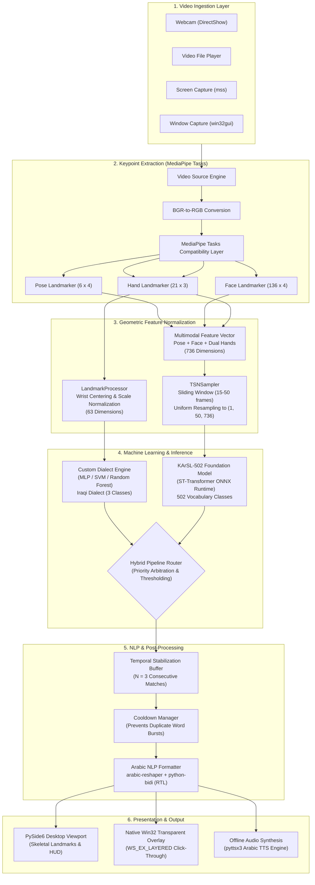

# Vision-Based Sign Language Recognition

**Real-Time Arabic Sign Language Translation & Subtitle Overlay System**

[]()
[]()
[-blue.svg)](https://www.python.org/)
[-lightgrey.svg)]()
[-orange.svg)](https://wiki.qt.io/Qt_for_Python)
[]()
[]()
[](LICENSE)

---

## Academic Information

| Item | Details |
| :--- | :--- |
| **Project Title** | **Vision-Based Sign Language Recognition** |
| **System Designation** | ArSL Translation Overlay System |
| **University** | **University of Basrah** (جامعة البصرة) |
| **College** | **College of Engineering** (كلية الهندسة) |
| **Department** | **Computer Engineering Department** (قسم هندسة الحاسوب) |
| **Project Type** | Undergraduate Graduation Project (مشروع تخرج) |
| **Academic Year** | **2026–2027** |
| **Project Supervisor** | **Asst. Prof. Dr. Hiba Hakim Abdulzahra** (أ.م.د. هبة حاكم عبد الزهرة) |

---

## Project Team

This graduation project was designed, engineered, and evaluated by the following undergraduate students from the Computer Engineering Department, College of Engineering, University of Basrah:

| # | Student Name (English) | Student Name (Arabic) | Primary Project Focus |
| :-: | :--- | :--- | :--- |
| 1 | **Adian Abdulsattar Abduljabbar Jasim** | أديان عبد الستار عبد الجبار جاسم | Computer Vision, Keypoint Extraction & Dataset Studio |
| 2 | **Rawan Issam Ghalib Joudi** | روان عصام غالب جودي | Machine Learning, Model Training & Dynamic Sequences |
| 3 | **Mustafa Nasser Mahmoud Saleh** | مصطفى ناصر محمود صالح | System Architecture, Win32 Overlay & Speech Synthesis |

---

## Table of Contents
1. [Project Overview](#1-project-overview)
2. [Hardware & Software System Requirements](#2-hardware--software-system-requirements)
3. [Disk Space Requirements & Installation Size Breakdown](#3-disk-space-requirements--installation-size-breakdown)
4. [Step-by-Step Installation & Execution Guide (Beginner-Friendly)](#4-step-by-step-installation--execution-guide-beginner-friendly)
5. [Key System Features](#5-key-system-features)
6. [System Architecture](#6-system-architecture)
7. [Recognition Models & Machine Learning](#7-recognition-models--machine-learning)
8. [Technology Stack](#8-technology-stack)
9. [Application Usage & Quick Start](#9-application-usage--quick-start)
10. [Dataset Management & Pre-Trained Model Guide](#10-dataset-management--pre-trained-model-guide)
11. [Custom Model Training & Evaluation (CLI Advanced)](#11-custom-model-training--evaluation-cli-advanced)
12. [Project Directory Structure](#12-project-directory-structure)
13. [Automated Testing & Verification](#13-automated-testing--verification)
14. [Limitations & Development Roadmap](#14-limitations--development-roadmap)
15. [Acknowledgments & Academic Citations](#15-acknowledgments--academic-citations)
16. [License](#16-license)

---

## 1. Project Overview

The **Vision-Based Sign Language Recognition System** is an engineering graduation project developed to bridge the communication barrier between the Deaf and Hard-of-Hearing (DHH) community and the hearing public across the Arabic-speaking world.

### 1.1 Societal & Engineering Problem
Traditional communication tools often require specialized physical hardware (such as sensor-embedded data gloves) or isolate the user inside standalone translation windows that interrupt day-to-day computer usage. When participating in online learning (e.g., Google Meet), virtual doctor consultations, or digital meetings (e.g., Microsoft Teams, Zoom), DHH individuals lack seamless subtitle translation integrated directly into their desktop environment.

### 1.2 The Proposed Solution
Our system provides a software-only, camera-based solution that performs real-time Arabic Sign Language recognition using standard webcams and projects live Arabic captions onto an unobstructed, click-through desktop overlay:
- **Zero Wearable Sensors:** Operates exclusively using standard 2D RGB video streams.
- **Multimodal Skeletal Tracking:** Leverages Google's modern MediaPipe Tasks Vision models to estimate 184 keypoints spanning body pose, facial contours, and dual hands.
- **Dual Recognition Engine:**
  - *Foundation Model:* A Spatio-Temporal Transformer (ST-Transformer) executed via ONNX Runtime supporting **502 discrete Arabic signs** (digits, letters, and everyday words).
  - *Localized Dialect Pipeline:* A customizable Scikit-Learn / PyTorch engine for collecting and training regional dialect signs (currently verified on Iraqi dialect gestures).
- **Arabic NLP Stabilization:** Employs temporal sliding-window buffers, gesture cooldowns, cursive Arabic letter reshaping (`arabic-reshaper`), and bidirectional text layout reordering (`python-bidi`).
- **Hardware Click-Through Subtitle Overlay:** Implements a native Windows layered window (`WS_EX_LAYERED | WS_EX_TRANSPARENT | WS_EX_TOPMOST`) that floats over video meetings without blocking user mouse clicks.
- **Integrated Arabic Text-to-Speech:** Features an asynchronous offline audio synthesis engine for spoken feedback.

### 1.3 Scope: Isolated Sign Recognition vs. Continuous Translation
> [!NOTE]
> **Operational Scope:** The current implementation performs **isolated sign and word recognition** coupled with an intelligent **State-Machine Sentence Builder**. Signs are recognized from temporal gesture windows and assembled into fluent sentences using stabilization filters and natural pause detection. The system does not employ unsegmented continuous sign translation (such as CTC or attention sequence-to-sequence networks), which is highlighted in the project roadmap.

---

## 2. Hardware & Software System Requirements

The application is engineered to operate on standard consumer PC hardware without requiring dedicated external GPUs:

| Component | Minimum Specification | Recommended Specification | Tested Development Machine |
| :--- | :--- | :--- | :--- |
| **Operating System** | Windows 10 (64-bit, 21H2+) | Windows 11 (64-bit) | Windows 11 Pro (64-bit) |
| **Processor (CPU)** | Intel Core i3 (8th Gen) / AMD Ryzen 3 | Intel Core i5 / i7 or AMD Ryzen 5 / 7 | Intel Core i5 / AMD Ryzen 5 |
| **System Memory (RAM)**| 8 GB DDR4 | 16 GB DDR4 | 16 GB DDR4 |
| **Video Camera** | USB Webcam or Laptop Cam (720p @ 15 FPS)| High-Definition Webcam (720p / 1080p @ 30 FPS)| 1080p @ 30 FPS Webcam |
| **Graphics (GPU)** | Intel UHD Graphics 620 (CPU inference) | NVIDIA GeForce GTX 1650 or higher (Optional) | Integrated Intel / AMD (CPU mode) |
| **Python Runtime** | Python 3.10 (64-bit) | Python 3.12 (64-bit) | **Python 3.12.4 (64-bit)** |
| **Internet Access** | Required only during installation (pip packages) | Offline during runtime (Zero cloud dependency) | Fully offline operation |

---

## 3. Disk Space Requirements & Installation Size Breakdown

The following breakdown provides exact measurements and verified estimates for setting up the project on a fresh Windows system.

### Detailed Component Storage Breakdown

| Component Name | Status | Estimated Download Size | Installed Disk Space | Purpose & Technical Explanation |
| :--- | :---: | :---: | :---: | :--- |
| **Python 3.12 (64-bit)** | **Required** | ~25 MB | ~115 MB | Official Windows installer runtime and standard library. |
| **Git for Windows** | Optional | ~55 MB | ~325 MB | Required only if using `git clone` (optional if downloading ZIP). |
| **Virtual Environment Base** | **Required** | *None (local)* | ~18 MB | Python virtual environment scaffolding (`.venv/Scripts`, `pyvenv.cfg`). |
| **PySide6 (Qt 6 Framework)** | **Required** | ~170 MB | ~647 MB | Full Qt 6 desktop application UI libraries, OpenGL, and QSS engines. |
| **PyTorch (CPU-Only)** | **Required** | ~185 MB | ~514 MB | Sequence model architectures (`SignTransformer`, `LSTMClassifier`). |
| **OpenCV (`opencv-python`)** | **Required** | ~35 MB | ~138 MB | Computer vision camera acquisition and DirectShow capture engine. |
| **SciPy & Scientific Tools** | **Required** | ~30 MB | ~128 MB | Mathematical optimization routines and signal processing. |
| **Google MediaPipe** | **Required** | ~32 MB | ~68 MB | MediaPipe Tasks Vision API for pose, face, and hand tracking. |
| **ONNX Runtime Engine** | **Required** | ~18 MB | ~46 MB | Hardware-accelerated inference session for KArSL-502 ST-Transformer. |
| **Scikit-Learn (`sklearn`)** | **Required** | ~12 MB | ~41 MB | Machine learning static classifiers (MLP, SVM, Random Forest). |
| **NumPy & Core Math** | **Required** | ~15 MB | ~51 MB | Multi-dimensional tensor manipulation and linear algebra. |
| **Matplotlib & Visualization**| **Required** | ~10 MB | ~46 MB | Analytics graphing and training loss/accuracy curve plotting. |
| **Arabic NLP (`reshaper` + `bidi`)**| **Required** | ~2 MB | ~5 MB | Cursive glyph shaping and Right-to-Left bidirectional reordering. |
| **System Tools (`psutil`, `pywin32`)**| **Required** | ~8 MB | ~25 MB | Win32 layered click-through overlays and system hardware telemetry. |
| **Pretrained Models & Tasks** | **Required** | ~35 MB | **34.88 MB** | Actual on-disk size: `karsl_502.onnx` (7.33 MB) + 3 `.task` models (27.3 MB) + Iraqi models (0.22 MB). |
| **Word & Sequence Datasets** | **Required** | ~1 MB | **0.13 MB** | Actual on-disk size: 177 real captured word landmark files (`.npy`). |
| **Project Source Code & Tests**| **Required** | ~2 MB | **1.75 MB** | Clean application source code, UI styles, tests, and configuration files. |
| **Pip Cache (Temporary)** | Temporary | ~600 MB | ~600 MB | Downloaded wheel archives in `%LocalAppData%\pip\cache` (Safe to purge). |

### Storage Summary

```
┌──────────────────────────────────────────────────────────────────────────────────┐
│                           DISK SPACE BUDGET SUMMARY                              │
├─────────────────────────────────────────────────┬────────────────────────────────┤
│ Category                                        │ Storage Requirement            │
├─────────────────────────────────────────────────┼────────────────────────────────┤
│ Python 3.12 Runtime                             │ ~115 MB                        │
│ Project Source Code & Pretrained AI Models      │ ~37 MB                         │
│ Complete Virtual Environment (.venv)            │ ~1,930 MB (1.88 GB)            │
│ Optional Git for Windows                        │ ~325 MB                        │
├─────────────────────────────────────────────────┼────────────────────────────────┤
│ TOTAL PERMANENT INSTALLED SPACE                 │ ~2,082 MB (~2.03 GB)           │
│ Temporary Installation Cache (Pip Wheels)       │ ~600 MB (Cleanable)            │
│ RECOMMENDED FREE DISK SPACE                     │ ≥ 5.0 GB                       │
└─────────────────────────────────────────────────┴────────────────────────────────┘
```

> [!TIP]
> **CPU-Only vs. GPU-Enabled Installation:**  
> The project defaults to **PyTorch CPU** and **ONNX Runtime CPU**, requiring only **~1.9 GB** for the entire virtual environment. Installing GPU-enabled PyTorch with CUDA 12.x wheels increases disk consumption by an additional **~4.5 GB** due to NVIDIA cuDNN and cuBLAS binaries. Since the KArSL model executes in 45–65 ms on standard modern CPUs, the CPU installation is optimal for consumer PCs.

---

## 4. Step-by-Step Installation & Execution Guide (Beginner-Friendly)

This section provides complete, step-by-step instructions designed so that **anyone with a fresh Windows computer** can install, configure, and launch the system without prior programming knowledge.

```
+-----------------------------------------------------------------------------------+
|                         INSTALLATION ROADMAP OVERVIEW                             |
|                                                                                   |
|  [Step 1: Install Python 3.12] ──> [Step 2: Get Code] ──> [Step 3: Open Terminal]  |
|                                                                      │            |
|  [Step 8: Launch App] <── [Step 6: Install Packages] <── [Step 4-5: .venv Setup]  |
+-----------------------------------------------------------------------------------+
```

---

### Step 1: Install Python 3.12 (64-bit)
1. Open your web browser and navigate to the official Python download page:  
   👉 **[https://www.python.org/downloads/release/python-3124/](https://www.python.org/downloads/release/python-3124/)**
2. Scroll to the bottom table titled **Files** and click on **Windows installer (64-bit)** to download the installer (`python-3.12.4-amd64.exe`).
3. Run the downloaded installer.
4. ⚠️ **CRITICAL STEP:** On the very first screen, check the box labeled:  
   ✅ **"Add python.exe to PATH"** *(Located at the bottom of the installer window)*.
5. Click **"Install Now"**.
6. When installation finishes, if a button appears labeled **"Disable path length limit"**, click it, then click **"Close"**.

---

### Step 2: Download the Project Files
Choose **Option A** (Simplest) or **Option B**:
- **Option A (Download ZIP - No Git Required):**
  1. Click the green **Code** button on the GitHub page and select **Download ZIP**.
  2. Extract the downloaded ZIP archive onto your computer (e.g., into `C:\arabic sign language` or `X:\arabic sign language`).
- **Option B (Clone via Git):**
  ```powershell
  git clone <repository_url> "X:\arabic sign language"
  ```

---

### Step 3: Open Windows PowerShell in the Project Directory
1. Open the project folder in Windows File Explorer.
2. Click on an empty space inside the folder while holding the **Shift** key on your keyboard, then select **"Open PowerShell window here"** or **"Open in Terminal"**.
3. *Alternative:* Press `Windows Key + R`, type `powershell`, press Enter, and navigate to the folder using:
   ```powershell
   cd "X:\arabic sign language"
   ```
   *(Note: Always wrap the folder path in quotation marks if it contains spaces).*

---

### Step 4: Configure Execution Policy & Create the Virtual Environment
Windows PowerShell may block third-party scripts by default. Run the following command once to allow local virtual environment activation:

```powershell
Set-ExecutionPolicy -ExecutionPolicy RemoteSigned -Scope CurrentUser
```
*(Press `Y` and Enter when prompted).*

Now, create an isolated virtual environment named `.venv` using Python 3.12:

```powershell
py -3.12 -m venv .venv
```
*(Wait 10–15 seconds while Windows creates the environment folder).*

---

### Step 5: Activate the Virtual Environment
Activate your newly created environment:

```powershell
.\.venv\Scripts\Activate.ps1
```

> [!NOTE]
> Upon successful activation, your PowerShell prompt will show a green `(.venv)` prefix at the beginning of the command line:  
> `(.venv) PS X:\arabic sign language>`

---

### Step 6: Upgrade Pip and Install Dependencies
With `(.venv)` active, execute the following commands in order:

```powershell
# 1. Upgrade Python package installer
python -m pip install --upgrade pip setuptools wheel

# 2. Install all required dependencies from requirements.txt
pip install -r requirements.txt

# 3. Install the application in editable development mode
pip install -e .
```
*(This process downloads approximately 1.1 GB of wheels and installs them into `.venv`. It typically takes 3 to 6 minutes depending on your internet connection).*

---

### Step 7: Verify Pretrained Models and Assets
Run the following PowerShell command to confirm all required neural network models are present:

```powershell
Get-ChildItem -Path data\models\karsl
```

You should see the following files listed:
- `karsl_502.onnx` (7,330,073 bytes — The 502-class ST-Transformer model)
- `labels.json` (502 bilingual Arabic/English sign dictionary labels)
- `hand_landmarker.task` (MediaPipe 3D Hand model)
- `pose_landmarker.task` (MediaPipe Body Pose model)
- `face_landmarker.task` (MediaPipe Facial Mesh model)

---

### Step 8: Launch the Application!
Launch the complete desktop application with a single, simple command from the project root or **any project subdirectory** (`src/`, `src/models/`, `src/presentation/`, `tests/`, `docs/`, etc.):

```powershell
# Primary one-command launcher (Recommended):
python run.py

# Or simply:
python run
```

> [!TIP]
> **Zero Manual Setup & Automatic Virtual Environment Detection:**
> - **Runs from Any Subdirectory:** You can run `python run` or `python run.py` directly from the project root or any subfolder (`src/`, `src/models/`, `tests/`, etc.) without typing `cd` to navigate to the project root.
> - **Automatic `.venv` Selection:** If invoked via system Python, the launcher automatically detects the project's isolated Python 3.12 virtual environment at `.\.venv\Scripts\python.exe` and re-dispatches execution into it. You do **not** need to manually run `.\.venv\Scripts\Activate.ps1`.
> - **Pre-Flight Asset Checks:** `run.py` verifies all required dependencies (`PySide6`, `mediapipe`, `onnxruntime`, `opencv-python`) and AI model checkpoints before launching the PySide6 Qt GUI.

#### Optional: Project-Wide Subdirectory Discovery Setup
If you create new nested folders inside the project, you can run the one-time launcher configuration tool:
```powershell
python scripts\setup_launcher.py
# Or in PowerShell:
.\scripts\setup_launcher.ps1
```
This registers the project directory in your user-level environment so `python run` works across any newly created subdirectories without manual configuration.

#### Alternative Direct Launch Methods:
```powershell
# Direct virtual environment executable path:
.\.venv\Scripts\python.exe run.py

# Direct module execution:
python -m src.main
```

The dark-themed application window will open, presenting the **System Dashboard**.

---

### Step 9: Beginner Troubleshooting FAQ

| Problem / Error | Cause | Solution |
| :--- | :--- | :--- |
| **`scripts is disabled on this system`** | PowerShell script restriction. | Run `Set-ExecutionPolicy -ExecutionPolicy RemoteSigned -Scope CurrentUser`, then re-run `.\.venv\Scripts\Activate.ps1`. |
| **`No module named 'PySide6'`** | Virtual environment is not active. | Ensure the `(.venv)` prompt is visible. Run `.\.venv\Scripts\Activate.ps1` before launching. |
| **Camera displays black frame or fails to start** | Camera is in use by Zoom/Teams or camera privacy settings block access. | Close other video applications. In Windows Settings, go to **Privacy & Security $\to$ Camera** and ensure **"Let desktop apps access your camera"** is toggled ON. |
| **`Cannot find path because it contains spaces`** | Missing quotation marks in PowerShell. | Always wrap paths containing spaces in double quotes and prefix with `&`: `& ".\.venv\Scripts\python.exe" src\main.py`. |
| **Application UI text appears blurry** | High-DPI screen scaling in Windows. | Right-click your desktop $\to$ Display settings $\to$ Scale $\to$ Set to 100% or 125%. |

---

## 5. Key System Features

### 5.1 Implemented & Verified Functionality
- **Pretrained KArSL-502 Foundation Engine:**
  - Out-of-the-box recognition for **502 discrete Arabic signs**.
  - Covers digits (0–30), the Arabic alphabet (31–69), and common vocabulary (70–501).
  - Spatial-Temporal Transformer executed via ONNX Runtime on an input tensor of shape `(1, 50, 736)`.
  - Non-blocking background worker thread (`QThread`) with frame-dropping queues to maintain a smooth 30 FPS camera feed.
- **Custom Iraqi Dialect Engine:**
  - Locally trained classifiers (Multi-Layer Perceptron, Support Vector Classifier, Random Forest) for Iraqi dialect signs (`السلام_عليكم`, `نعم`, `لا`).
  - Processes 63-dimensional wrist-centered, scale-invariant hand vectors.
- **Modern MediaPipe Tasks Compatibility:**
  - Wraps Google's modern `mediapipe.tasks.python.vision` API using self-contained `.task` model bundles.
  - Generates strictly monotonic microsecond timestamps to eliminate frame dropping and synchronization crashes.
- **Multi-Source Video Capture:**
  - Supports 4 input adapters: **Webcam** (DirectShow backend), **Video File** (.mp4/.avi loopable playback), **Screen Region Capture** (`mss`), and **Application Window Capture** (`win32gui`).
- **Hardware-Accelerated Win32 Transparent Overlay:**
  - Native Windows layered window (`WS_EX_LAYERED | WS_EX_TRANSPARENT | WS_EX_TOPMOST`).
  - Complete click-through capability: mouse clicks pass directly through subtitle captions into meeting windows below.
  - Cross-platform Qt frameless fallback for other operating systems.
- **Arabic Text Formatting & Speech Synthesis:**
  - Resolves cursive letter joining via `arabic-reshaper` and Right-to-Left (RTL) ordering via `python-bidi`.
  - Integrated offline Text-to-Speech (TTS) using `pyttsx3` with automatic Windows SAPI5 Arabic voice discovery.
- **8-Tab PySide6 Desktop Studio:**
  - *Dashboard:* Real-time FPS, CPU/RAM telemetry, active camera info.
  - *Dataset:* Visual sample recorder with bounding boxes and metadata export.
  - *Training:* Model architecture selection, hyperparameter tuning, live loss/accuracy graphs.
  - *Recognition:* Live viewport, skeletal joint rendering, confidence HUD, and dictionary lookups.
  - *Overlay:* Controls for subtitle opacity, font size, positioning, and auto-hide timeouts.
  - *Analytics:* Latency breakdown (capture vs. detection vs. inference) and dialect distribution charts.
  - *Settings:* Camera index selection, backend resolution presets, confidence thresholds.
  - *Logs:* Live system log viewer with severity filtering and text export.
- **Interactive 502-Sign Bilingual Dictionary:**
  - Searchable pop-up table displaying all 502 sign names in Arabic and English with classification categories.

### 5.2 Partially Implemented / Experimental Capabilities
- **Dynamic Sequence Model Architectures:**
  - Full PyTorch implementations for `SignTransformer`, `LSTMClassifier`, and `GRUClassifier` exist in `src/models/train_dynamic.py`.
  - *Limitation:* The dynamic sequence dataset currently contains 1 recorded sample (`data/datasets/dynamic/السلام_عليكم/`). Additional multi-frame sequences must be recorded to train sequence models.
- **Regional Dialect Scaffolding:**
  - Directory structures for `saudi` and `egyptian` dialects exist in `data/datasets/`, but currently contain zero collected samples.

---

## 6. System Architecture

The project adheres to **Clean Architecture** and **Ports & Adapters (Hexagonal)** principles:



---

## 7. Recognition Models & Machine Learning

```
┌──────────────────────────────────────────────────────────────────────────────────┐
│                             RECOGNITION MODEL MATRIX                             │
├─────────────────────┬───────────────────────────┬────────────────────────────────┤
│ Feature             │ KArSL-502 Engine          │ Custom Dialect Engine          │
├─────────────────────┼───────────────────────────┼────────────────────────────────┤
│ Architecture        │ Spatio-Temporal Transform │ MLP / Linear SVM / Rand Forest │
│ Runtime Framework   │ ONNX Runtime (CPU/DirectML)│ Scikit-Learn (Joblib serialized│
│ Model Weights File  │ data/models/karsl/        │ data/models/iraqi/             │
│                     │ karsl_502.onnx (7.33 MB)  │ static_model.pkl (209 KB)      │
│ Input Tensor Shape  │ (1, 50, 736) float32      │ (1, 63) float32                │
│ Feature Definition  │ 184 keypoints x 4 (x,y,z,v)│ 21 hand landmarks x 3 (x,y,z)  │
│ Temporal Handling   │ TSNSampler (50 timesteps) │ Single frame / spatial snapshot│
│ Vocabulary Size     │ 502 classes               │ 3 verified classes (Iraqi)     │
│ Supported Signs     │ Digits, Alphabet, Words   │ السلام_عليكم, نعم, لا           │
└─────────────────────┴───────────────────────────┴────────────────────────────────┘
```

### 7.1 Pretrained Model: KArSL-502 ST-Transformer
- **Checkpoint Location:** `data/models/karsl/karsl_502.onnx` (file size: **7,330,073 bytes**).
- **Label Map:** `data/models/karsl/labels.json` containing 502 discrete classes.
- **Multimodal Topology:**
  Consumes $184 \text{ keypoints} \times 4 \text{ values } (x, y, z, \text{visibility}) = 736 \text{ features}$:
  1. *Body Pose (6 keypoints):* Shoulders, Elbows, Wrists (centered on Nose; scaled by shoulder width).
  2. *Face Contours (136 keypoints):* Oval, lips, and eyes (centered on Nose tip; scaled by eye distance).
  3. *Right Hand (21 keypoints):* Full hand skeleton (centered on Right Wrist; scaled by palm span).
  4. *Left Hand (21 keypoints):* Full hand skeleton (centered on Left Wrist; scaled by palm span).
- **Temporal Segment Network Sampling:**
  Incoming frames are buffered in a sliding window ($15 \le N \le 50$ frames). `TSNSampler` resamples the sequence to 50 uniform timesteps, yielding an exact input tensor of shape `(1, 50, 736)`.

### 7.2 Custom Iraqi Dialect Models
- **Trained Checkpoints:**
  - `data/models/iraqi/static_model.pkl`: Multi-Layer Perceptron (`MLPClassifier`, 207 KB).
  - `data/models/iraqi/static_mlp.pkl`: MLP Classifier backup checkpoint (207 KB).
  - `data/models/iraqi/static_svm.pkl`: Support Vector Classifier (`SVC`, 14 KB).
  - `data/models/iraqi/classes.json`: `["آسف", "أكل", "السلام_عليكم", "لا", "نعم", "نوم"]` (6 classes).
- **Feature Vector:** 21 hand landmarks $\times 3 \text{ coordinates } (x, y, z) = 63 \text{ features}$.
- **Dataset Context & Metrics:**
  - **1,037 Static Samples** recorded across 6 vocabulary classes (`آسف`: 212, `أكل`: 159, `السلام_عليكم`: 300, `لا`: 67, `نعم`: 273, `نوم`: 26).
  - **8 Dynamic Sequences** recorded across 4 motion classes (`أكل`: 4, `السلام_عليكم`: 1, `نعم`: 2, `نوم`: 1).
  - Ready for immediate real-time inference without retraining.

---

## 8. Technology Stack

| Category | Component / Library | Minimum Version | Verified Runtime Version | Purpose |
| :--- | :--- | :--- | :--- | :--- |
| **Language Runtime**| Python | `>=3.10` | `3.12.4 (64-bit)` | Core runtime execution environment. |
| **Desktop GUI** | `PySide6` (Qt 6) | `>=6.5.0` | `6.7.x / 6.8.x` | Modern dark desktop GUI, canvas rendering, and threading (`QThread`). |
| **Computer Vision** | `opencv-python` | `>=4.8.0` | `4.10.0.84` | Video capture, DirectShow backend, BGR/RGB conversion. |
| **Landmark Tracking**| `mediapipe` | `>=0.10.0` | `0.10.14` | MediaPipe Tasks Vision API for pose, face, and hand estimation. |
| **Deep Learning** | `onnxruntime` | `>=1.15.0` | `1.18.0` | Hardware-accelerated inference of KArSL ST-Transformer. |
| **Sequence Models** | `torch`, `torchvision` | `>=2.0.0` | `2.4.0+cpu` | PyTorch sequence models (LSTM, GRU, Transformer) in `train_dynamic.py`. |
| **Machine Learning**| `scikit-learn` | `>=1.3.0` | `1.5.0` | Static sign classifiers (MLP, SVM, Random Forest). |
| **Screen Ingestion** | `mss` | `>=9.0.0` | `9.0.1` | High-throughput desktop region grabbing. |
| **Window Ingestion** | `pywin32` | `>=306` | `306` | Windows GDI capture and native layered window click-through styles. |
| **Arabic NLP** | `arabic-reshaper` | `>=2.1.0` | `3.0.0` | Cursive glyph connection and Arabic text shaping. |
| **Arabic Layout** | `python-bidi` | `>=0.4.0` | `0.6.6` | Unicode Bidirectional Algorithm for Right-to-Left (RTL) rendering. |
| **Text-to-Speech** | `pyttsx3` | `>=2.90` | `2.98` | Offline Arabic speech synthesis. |
| **Telemetry** | `psutil` | `>=5.9.0` | `5.9.8` | Real-time monitoring of CPU percentage and RAM memory footprint. |
| **Configuration** | `PyYAML` | `>=6.0` | `6.0.2` | Hierarchical YAML configuration (`default.yaml`, `user.yaml`). |
| **Testing** | `pytest`, `pytest-cov` | `>=7.4.0` | `8.3.4` | Automated test suite (208 passing unit and integration tests). |

---

## 9. Application Usage & Quick Start

```
┌──────────────────────────────────────────────────────────────────────────────────┐
│                       VISION-BASED SIGN LANGUAGE RECOGNITION                     │
├───────────┬──────────┬──────────┬─────────────┬─────────┬───────────┬────────┬───┤
│ Dashboard │ Dataset  │ Training │ Recognition │ Overlay │ Analytics │Settings│Log│
├───────────┴──────────┴──────────┴─────────────┴─────────┴───────────┴────────┴───┤
│                                                                                  │
│   [ Camera Video Stream Viewport ]          [ Real-Time Translation Panel ]      │
│   • 640x480 @ 30 FPS                        • Detected Sign: السلام عليكم        │
│   • 184 Multimodal Keypoints Rendered       • Confidence: 94.2%                  │
│   • Left/Right Hand Distinction             • Engine: KArSL-502 (ST-Transformer) │
│                                             • Text-to-Speech: Active [🔊]        │
│                                                                                  │
│   [ Gesture Stability Buffer ]              [ Assembled Sentence ]               │
│   [██████████████████░░░░] 3/4 Stable       السلام عليكم ورحمة الله              │
│                                                                                  │
└──────────────────────────────────────────────────────────────────────────────────┘
```

1. **Launch the Application:** Run `python run.py` (or `python run`) from your project root with your virtual environment active. (Alternative: `python -m src.main`).
2. **Switch to the Recognition Tab:** Click on the **«🎯 Recognition»** tab.
3. **Select Camera from Unified Dropdown:**
   - Both your built-in **`HD Webcam (Built-in Laptop Camera)`** and iPhone **`e2eSoft iVCam (iPhone Camera)`** appear simultaneously in the single **Camera** dropdown.
   - Switch between them instantaneously at any time without disconnecting hardware or restarting the application.
   - Click the **`🔄 Refresh`** button beside the dropdown to detect newly connected webcams or iVCam sessions.
4. **Choose Sign Recognition Model:**
   - **`KArSL-502 (502 Standard Signs)`:** Full Spatio-Temporal Transformer recognizing 502 isolated Arabic signs and common vocabulary.
   - **`Iraqi Custom Classifier`:** Lightweight local classifier trained on custom regional dialect gestures.
   - Click **`502 Signs List`** to inspect the complete searchable dictionary of all 502 supported Arabic signs.
5. **Interactive Controls & Sentence Construction:**
   - **`Start Camera / Stop Camera`:** Toggle real-time capture and AI inference with a single click.
   - **`Show Landmarks`:** Toggle skeletal hand and pose visual overlays.
   - **`Mirror Feed`:** Flips the camera preview horizontally for intuitive user interaction.
   - **`Resolution Selector`:** Switch between `640x480 (Fast)` and `1280x720 (HD)`.
   - **`Sentence Builder`:** Recognized words accumulate in the Arabic text box. Use **`Speak (TTS)`** for speech output, **`Space`**, **`Delete Word`**, and **`Clear`**.
   - **`Toggle Desktop Subtitles`:** Enable or disable floating transparent subtitles directly from the recognition viewport.
   - **`Screenshot`:** Instantly saves annotated frames to `data/captures/`.

---

### 9.1 Smartphone Camera Integration Guide

The system supports smartphones (Android and iPhone/iOS) as primary video sources via two methods:

#### Method A: Wi-Fi Streaming (No Cable Required)
1. **Connect to Same Network:** Ensure both your laptop and smartphone are connected to the same Wi-Fi router or laptop mobile hotspot.
2. **Install Mobile Streaming App:**
   - **Android:** Install *IP Webcam* (by Pavel Khlebovich) or *DroidCam*.
   - **iPhone (iOS):** Install *DroidCam Webcam & OBS*, *IP Camera Lite*, or *EpocCam*.
3. **Start Server on Phone:** Tap **Start Server** inside the phone application.
4. **Copy Stream URL:** Note the URL displayed on your phone screen:
   - Android IP Webcam format: `http://192.168.1.X:8080/video`
   - DroidCam format: `http://192.168.1.X:4747/video`
   - Generic MJPEG format: `http://192.168.1.X:8080/mjpegfeed`
5. **Connect in App:** In the desktop GUI, select **Phone Camera (Wi-Fi)**, paste your phone's URL (or use the convenient presets dropdown), and click **🔗 Connect**.

#### Method B: iPhone & Smartphone USB / Virtual Webcam (e2eSoft iVCam, DroidCam, Iriun)
1. **Install Virtual Driver:** Install the PC companion software (e.g., *e2eSoft iVCam*, *Iriun 4K Webcam*, or *DroidCam PC Client*).
2. **Install Matching Mobile App:** Install the corresponding mobile app on your iPhone or Android phone.
3. **Connect Device:** Connect your phone via USB cable or Wi-Fi; Windows automatically registers the virtual device in DirectShow.
4. **Instant Selection:** Open the application, click **`🔄 Refresh`**, and select **`e2eSoft iVCam (iPhone Camera)`** directly from the **Camera** dropdown alongside your built-in **`HD Webcam (Built-in Laptop Camera)`**. Both cameras remain available simultaneously.

---

## 10. Dataset Management & Pre-Trained Model Guide

This repository contains **100% of the actual collected training samples and pre-trained models**. After cloning the repository, you do **not** need to collect data or retrain the system; the pre-trained Iraqi Custom Classifier and KArSL-502 models work immediately.

### 10.1 Where Files are Stored

| Asset | Storage Location | Files & Description |
| :--- | :--- | :--- |
| **Static Sign Samples** | `data/datasets/words/<class_name>/samples/<sample_id>/` | **1,037 samples** across 6 classes (`آسف`, `أكل`, `السلام_عليكم`, `لا`, `نعم`, `نوم`). Each sample directory contains `landmarks.npy` (21×3 normalized coordinates) and `metadata.json`. |
| **Dynamic Sign Sequences** | `data/datasets/dynamic/<class_name>/samples/<sample_id>/` | **8 sequences** across 4 motion classes (`أكل`, `السلام_عليكم`, `نعم`, `نوم`). Contains multi-frame landmark arrays and metadata. |
| **Vocabulary Registry** | `data/vocabulary/gesture_classes.json` | Persistent JSON registry tracking all active and archived classes, categories, timestamps, and stable IDs. |
| **Iraqi Custom Classifier** | `data/models/iraqi/` | Pre-trained Scikit-learn MLP (`static_model.pkl`, `static_mlp.pkl`, 207 KB), SVM (`static_svm.pkl`, 14 KB), `classes.json`, `vocabulary.json`, and `evaluation.json`. |
| **KArSL-502 Foundation Model** | `data/models/karsl/` | Spatio-Temporal Transformer ONNX model (`karsl_502.onnx`, 6.99 MB) and 502 bilingual labels (`labels.json`). |
| **MediaPipe Vision Tasks** | `data/models/karsl/` & `data/models/general/` | Offline vision models: `hand_landmarker.task` (7.46 MB), `pose_landmarker.task` (8.96 MB), `face_landmarker.task` (3.58 MB). |

### 10.2 How to Clone the Repository
Clone the repository using Git:
```powershell
git clone https://github.com/xdc7-css/Vision-Based-Sign-Language-Recognition.git "X:\arabic sign language"
cd "X:\arabic sign language"
```

> [!NOTE]
> **Git LFS Details:** All essential active dataset samples (`.npy`, `.json`), trained Iraqi checkpoints (`.pkl`), and KArSL-502 ONNX models are under 10 MB and are tracked **directly in standard Git**. You can clone and run the system without installing Git LFS or consuming LFS data quotas. (Historical reference materials in `external/karsl_reference/` use Git LFS).

### 10.3 How to Launch the Application
```powershell
# 1. Activate your virtual environment
.\.venv\Scripts\Activate.ps1

# 2. Launch the desktop GUI
python run.py
```

### 10.4 How to Use the Pre-Trained Iraqi Custom Classifier
1. Open the application and switch to the **«🎯 Recognition»** tab.
2. Select your camera (*HD Webcam* or *e2eSoft iVCam*) from the single unified dropdown.
3. In the Model dropdown, select **`Iraqi Custom Classifier`**.
4. Click **`Start Camera`**.
5. Perform any of the 6 trained signs in front of the camera:
   - **`آسف`** (Sorry)
   - **`أكل`** (Eat)
   - **`السلام عليكم`** (Peace be upon you / Greeting)
   - **`لا`** (No)
   - **`نعم`** (Yes)
   - **`نوم`** (Sleep)
6. The system displays real-time hand skeletal tracking with joint connections, recognizes the sign, displays confidence scores, and appends the sign to the sentence builder with optional Arabic text-to-speech feedback.

### 10.5 How to Add, Rename, Archive, and Retrain Gestures
The system gives you complete user control over the gesture classes via the **Dataset Studio**:
1. Open the **«📷 Dataset»** tab.
2. **Add Class:** Click **`Add Class`**, enter any Arabic word or letter (e.g. `مرحبا`), select the gesture category (*Static Word*, *Dynamic Gesture*, *Both*, or *Alphabet*), and optional description. Sample folders on disk are created automatically.
3. **Rename Class:** Select an existing class and click **`Rename`**. It transactionally renames all sample folders on disk, updates all internal `metadata.json` files, and prevents duplicate collisions.
4. **Safe Archiving vs. Permanent Deletion:** Click **`Delete`**:
   - *Archive (Safe — Recommended):* Removes the class from active recognition and training, but keeps **100% of recorded sample files on disk** so data is never accidentally lost.
   - *Permanently Delete:* Removes the class and permanently deletes recorded samples after checking an explicit confirmation checkbox.
5. **Record Samples:** Select the target class, position your hand in front of the camera, and click **`Record Sample`** (for static frames) or **`Record Dynamic (30f)`** (for movement sequences).
6. **Retrain Model:** Open the **«🎓 Training»** tab, check the **Model Sync Status** badge, select training parameters (model architecture: MLP, SVM, Random Forest, epochs, and augmentation), and click **`Start Model Training`**. The newly trained model is evaluated and automatically registered for immediate use in Recognition.

---

## 11. Custom Model Training & Evaluation (CLI Advanced)

The system also provides standalone command-line scripts for batch training and academic evaluation:

### 11.1 Training Static Classifiers (CLI)
Train Random Forest, SVM, and MLP models with automatic cross-validation and best-model registration:

```powershell
python -m src.models.train_static --dataset data/datasets/words --output data/models/iraqi/static --models rf svm mlp --dialect iraqi
```

### 11.2 Training Dynamic Sequence Models (CLI)
For multi-frame motion gestures:

```powershell
python -m src.models.train_dynamic --dataset data/datasets/dynamic --output data/models/iraqi/dynamic --seq-len 30 --epochs 50 --dialect iraqi
```

### 11.3 Standalone Model Evaluation (CLI)
Evaluate any trained model checkpoint against a dataset directory:

```powershell
python -m src.models.evaluate --model data/models/iraqi/static_model.pkl --test-data data/datasets/words --output data/evaluations
```
This generates a detailed classification report, confusion matrix, and latency percentiles (mean, p90, p99).

---

## 12. Project Directory Structure

```
arabic sign language/
├── config/                               # Application configuration
│   ├── default.yaml                      # Core pipeline parameters & thresholds
│   ├── logging.yaml                      # Rotating log specifications
│   └── user.yaml                         # Runtime user overrides
├── data/
│   ├── datasets/
│   │   ├── words/                        # 1,037 real captured static word samples
│   │   │   ├── آسف/                      # 212 samples (.npy + metadata.json)
│   │   │   ├── أكل/                      # 159 samples (.npy + metadata.json)
│   │   │   ├── السلام_عليكم/             # 300 samples (.npy + metadata.json)
│   │   │   ├── لا/                       # 67 samples (.npy + metadata.json)
│   │   │   ├── نعم/                      # 273 samples (.npy + metadata.json)
│   │   │   └── نوم/                      # 26 samples (.npy + metadata.json)
│   │   └── dynamic/                      # 8 multi-frame sequence samples
│   │       ├── أكل/                      # 4 sequences (.npy + metadata.json)
│   │       ├── السلام_عليكم/             # 1 sequence (.npy + metadata.json)
│   │       ├── نعم/                      # 2 sequences (.npy + metadata.json)
│   │       └── نوم/                      # 1 sequence (.npy + metadata.json)
│   ├── models/
│   │   ├── karsl/                        # Foundation KArSL-502 model & task bundles
│   │   │   ├── karsl_502.onnx            # ST-Transformer ONNX model (6.99 MB)
│   │   │   ├── labels.json               # 502 bilingual sign labels
│   │   │   ├── hand_landmarker.task      # MediaPipe Hand Landmark model (7.46 MB)
│   │   │   ├── pose_landmarker.task      # MediaPipe Pose Landmark model (8.96 MB)
│   │   │   └── face_landmarker.task      # MediaPipe Face Landmark model (3.58 MB)
│   │   ├── general/
│   │   │   └── hand_landmarker.task      # MediaPipe Hand Vision Task (7.46 MB)
│   │   └── iraqi/                        # Pre-trained Custom Iraqi Dialect Models
│   │       ├── static_model.pkl          # Scikit-learn MLP classifier (207 KB, 6 classes)
│   │       ├── static_mlp.pkl            # MLP classifier checkpoint (207 KB)
│   │       ├── static_svm.pkl            # Scikit-learn SVM classifier (14 KB)
│   │       ├── classes.json              # Active class names ["آسف", "أكل", "السلام_عليكم", "لا", "نعم", "نوم"]
│   │       ├── vocabulary.json           # Arabic vocabulary & metadata
│   │       └── evaluation.json           # Evaluation metrics record
│   └── vocabulary/
│       └── gesture_classes.json          # Persistent Gesture Registry (single source of truth)
├── docs/                                 # Technical documentation
│   ├── technical-specification.md        # Detailed engineering specifications
│   ├── component-design.md               # Component interaction blueprints
│   └── ARCHITECTURE.md                   # Complete architectural reference
├── external/
│   └── karsl_reference/                  # Reference repository and attribution
├── src/                                  # Main application source code
│   ├── main.py                           # Application entry point & service bootstrap
│   ├── domain/                           # Clean domain layer (zero external deps)
│   │   ├── entities.py                   # Core business entities
│   │   ├── hand.py                       # Hand landmark definitions
│   │   ├── recognition.py                # Recognition domain types
│   │   ├── text.py                       # Text buffer & translation state
│   │   └── interfaces.py                 # Abstract base contracts
│   ├── infrastructure/                   # Concrete adapters & external bindings
│   │   ├── hand_detection/
│   │   │   ├── detector.py               # MediaPipeHandDetector implementation
│   │   │   ├── mediapipe_compatibility.py# Modern Tasks API adapter
│   │   │   ├── renderer.py               # Skeletal visualization
│   │   │   └── utils.py                  # LandmarkProcessor geometric normalization
│   │   ├── recognition/
│   │   │   ├── karsl_recognizer.py       # 736-dim ST-Transformer ONNX engine
│   │   │   ├── hybrid_pipeline.py        # Recognition routing pipeline
│   │   │   ├── static_recognizer.py      # Scikit-learn MLP/SVM/RF inference
│   │   │   └── dynamic_recognizer.py     # PyTorch LSTM/GRU/Transformer inference
│   │   ├── dataset/
│   │   │   └── gesture_registry.py       # Persistent vocabulary CRUD & folder manager
│   │   ├── video_source_engine.py        # Webcam, File, Screen, Window capture
│   │   ├── overlay_system.py             # Win32 click-through transparent overlay
│   │   ├── text_builder.py               # Arabic BiDi & sentence builder
│   │   ├── dialect_manager.py            # Dialect pack loader & registry
│   │   └── audio/tts_engine.py           # pyttsx3 offline Arabic TTS engine
│   ├── models/                           # Application modeling & training tools
│   │   ├── train_static.py               # Static classifier training CLI
│   │   ├── train_dynamic.py              # Dynamic sequence training CLI
│   │   ├── evaluate.py                   # Model evaluation CLI runner
│   │   └── evaluator.py                  # Metric computation & confusion matrices
│   └── presentation/                     # Presentation layer (PySide6 Qt 6)
│       ├── main_window.py                # Main window & tab coordinator
│       ├── dialogs/
│       │   ├── dataset_dialogs.py        # Add/Edit/Delete class & sample inspector
│       │   └── karsl_vocab_dialog.py     # 502-sign searchable table dialog
│       ├── styles/dark_theme.qss         # Modern dark glassmorphic styling
│       └── tabs/                         # Modular application tabs
│           ├── dashboard.py              # Telemetry & system status
│           ├── dataset.py                # Dataset Studio with search, filters & CRUD
│           ├── recognition.py            # Real-time camera recognition & sentence builder
│           ├── training.py               # Hyperparameter selection & model sync status
│           └── settings.py               # Camera, resolution, overlay & audio settings
├── tests/                                # Automated test suite (269 tests)
│   ├── test_gesture_classes_management.py# Full vocabulary CRUD, archiving & sync tests
│   ├── test_dataset_studio_and_training.py# Studio UI, recording & training tests
│   ├── test_karsl.py                     # KArSL-502 engine & TSNSampler tests
│   ├── test_camera_dropdown_and_switching.py # DirectShow unified camera & switching tests
│   ├── test_camera_stream_and_yolo.py    # Camera streaming & frame capture tests
│   ├── test_recognition.py              # Recognition pipeline unit tests
│   ├── test_hand_detection.py            # Hand tracking & normalization tests
│   ├── test_text_builder.py              # Arabic BiDi & stabilization tests
│   ├── test_overlay.py                   # Overlay subsystem tests
│   └── integration/                      # End-to-end integration tests
│       ├── test_pipeline_integration.py  # Full frame-to-prediction tests
│       └── test_performance_benchmarks.py# Latency benchmark tests
├── ARCHITECTURE.md                       # Comprehensive architecture manual
├── PROJECT_FILE_GUIDE.md                 # Exhaustive academic file guide for university presentation
├── README.md                             # Main landing documentation
├── requirements.txt                      # PIP dependency specifications
├── run                                   # Companion root-level launch script
├── run.py                                # Root-level application launcher & pre-flight checker
├── setup.py                              # Package installation configuration
└── sitecustomize.py                      # Global project-wide launcher discovery hook
```

---

## 13. Automated Testing & Verification

The project includes an automated test suite verifying domain contracts, computer vision adapters, inference engines, text shaping, gesture CRUD operations, and integration workflows.

### 13.1 Running the Tests
```powershell
# Run the complete test suite
python -m pytest

# Run with verbose output
python -m pytest -v

# Run gesture classes management tests specifically
python -m pytest tests\test_gesture_classes_management.py -v

# Run KArSL-502 engine verification tests specifically
python -m pytest tests\test_karsl.py

# Run integration tests
python -m pytest tests\integration\
```

### 13.2 Verified Test Output
```
============================= test session starts =============================
platform win32 -- Python 3.12.4, pytest-9.2.0, pluggy-1.7.0
rootdir: X:\arabic sign language
configfile: pyproject.toml
plugins: anyio-4.16.0, cov-7.1.0
collected 269 items

tests\integration\test_config_integration.py ........                    [  2%]
tests\integration\test_data_augmentation.py ......                       [  5%]
tests\integration\test_model_export.py ....                              [  6%]
tests\integration\test_performance_benchmarks.py ..........              [ 10%]
tests\integration\test_pipeline_integration.py ................          [ 16%]
tests\test_analytics.py .............                                    [ 21%]
tests\test_camera_black_preview_regression.py ........                   [ 24%]
tests\test_camera_dropdown_and_switching.py .............                [ 28%]
tests\test_camera_stream_and_yolo.py .............                       [ 33%]
tests\test_dataset.py ....................                               [ 41%]
tests\test_dataset_studio_and_training.py .........                      [ 44%]
tests\test_dialect_manager.py ...............                            [ 50%]
tests\test_gesture_classes_management.py .............                   [ 55%]
tests\test_hand_detection.py ....................................        [ 68%]
tests\test_hybrid_pipeline.py ............                               [ 72%]
tests\test_karsl.py ....                                                 [ 74%]
tests\test_motion_tracking.py ..............                             [ 79%]
tests\test_overlay.py .............                                      [ 84%]
tests\test_recognition.py ....................                           [ 91%]
tests\test_recognition_custom_and_landmarks.py .....                     [ 93%]
tests\test_text_builder.py .................                             [100%]

====================== 269 passed, 4 warnings in 48.22s =======================
```
- **Total Tests:** 269
- **Passing:** 269 (100% pass rate)
- **Failures:** 0
- **Execution Duration:** 48.22 seconds

---

## 14. Limitations & Development Roadmap

### Known System Limitations
1. **Custom Iraqi Vocabulary Scale:** The pre-trained custom dialect classifier contains weights for 6 gestures (`آسف`, `أكل`, `السلام_عليكم`, `لا`, `نعم`, `نوم`). Additional custom gestures can be added and recorded dynamically through the Dataset Studio tab.
2. **Lighting & Occlusion Sensitivity:** MediaPipe landmark estimation accuracy degrades under severe backlighting, low-light environments, rapid motion blur, and hand-over-face occlusions.
3. **Platform Dependence of Hardware Click-Through:** Native click-through transparency relies on Windows User32 API attributes (`WS_EX_LAYERED | WS_EX_TRANSPARENT`). On Linux and macOS, the system falls back to a standard frameless translucent Qt window.
4. **Continuous Sign Translation Boundary:** The system recognizes discrete signs and concatenates them using a temporal state machine with stability thresholds. It does not perform unsegmented continuous sentence decoding.

### Project Roadmap
- [ ] **Phase 1: Custom Dialect Expansion**
  - Collect and annotate at least 50 samples per class for 20+ everyday signs across Iraqi, Saudi, and Egyptian dialects.
  - Expand dynamic sequence capture sessions in the Dataset Studio tab.
- [ ] **Phase 2: Hardware Acceleration Integration**
  - Integrate `onnxruntime-directml` for GPU-accelerated KArSL ST-Transformer inference on Intel, AMD, and NVIDIA hardware on Windows.
  - Optimize memory footprint during continuous multi-hour streaming.
- [ ] **Phase 3: End-to-End Continuous Translation**
  - Investigate sequence-to-sequence Transformer architectures and Connectionist Temporal Classification (CTC) for continuous sentence decoding without requiring pauses between signs.
- [ ] **Phase 4: Cross-Platform Click-Through Support**
  - Implement native click-through transparency for macOS (using Objective-C Cocoa `NSWindow` mouse event ignore masks) and Linux (via X11 `XShapeCombineRectangles`).

---

## 14. Acknowledgments & Academic Citations

### 14.1 Academic Supervision
We extend our deepest gratitude to our project supervisor, **Asst. Prof. Dr. Hiba Hakim Abdulzahra** (أ.م.د. هبة حاكم عبد الزهرة), for her academic guidance, continuous mentorship, and valuable technical feedback throughout the development of this undergraduate graduation project at the **University of Basrah, College of Engineering, Computer Engineering Department**.

### 14.2 KArSL-502 Reference Implementation
The foundation recognition model is derived from the **Word-Level Arabic Sign Language Recognition** project by **Yousef Elkilany**:
- Repository reference commit: `da49b778226c43fc7b0dc791d1062f9195b4086c`
- License: MIT License (Copyright © 2025 Yousef Elkilany, preserved in `external/karsl_reference/LICENSE`).

### 14.3 KArSL Dataset Citation
If you use the KArSL-502 model or derived weights in academic work, please cite the original KArSL database publication:

```bibtex
@article{sidig2021karsl,
    title={KArSL: Arabic Sign Language Database},
    author={Sidig, Ala Addin I and Luqman, Hamzah and Mahmoud, Sabri and Mohandes, Mohamed},
    journal={ACM Transactions on Asian and Low-Resource Language Information Processing (TALLIP)},
    volume={20},
    number={1},
    pages={1--19},
    year={2021},
    publisher={ACM New York, NY, USA}
}
```

### 14.4 Technology Acknowledgments
- **Google MediaPipe:** For real-time landmark estimation models (`hand_landmarker.task`, `pose_landmarker.task`, `face_landmarker.task`).
- **The Qt Company:** For the PySide6 framework powering the graphical user interface.
- **ONNX Runtime:** For cross-platform neural network execution.

---

## 15. License

The **Vision-Based Sign Language Recognition System** is open-source software licensed under the **[MIT License](LICENSE)**. Third-party models and reference assets in `external/` remain subject to their respective original licenses.
