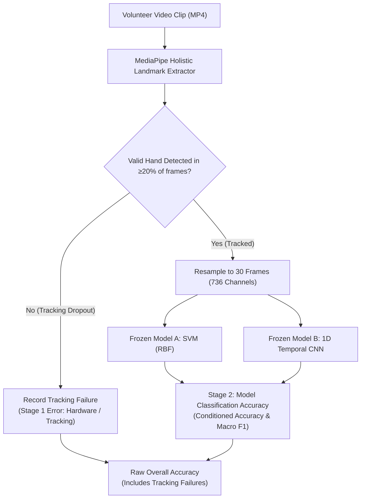

# Independent Human Recognition Evaluation Protocol & Architecture
## Scientific Validation for Vision-Based Arabic Sign Language Recognition

**Project:** Vision-Based Arabic Sign Language Recognition (ArSL Studio)  
**Supervisor:** Dr. Hiba Hakim Abdulzahra  
**Department:** Computer Engineering Department, University of Basrah  
**Date:** November 2026  
**Status:** `PENDING_VOLUNTEER_RECORDINGS` (Strict Academic Integrity Enforced)  

---

## 1. Executive Summary & Purpose

The existing benchmark on the **KArSL-502** dataset demonstrated Leave-One-Signer-Out (LOSO) cross-validation on the 3 available signers (`Signer01`, `Signer02`, and `Signer03`). While LOSO cross-validation prevents direct sample overlap between training and testing folds, true real-world generalization must be assessed on **independent human volunteers** who were never involved in the original KArSL collection or pipeline development.

This document formalizes the **Independent Human Recognition Evaluation Protocol**, detailing:
1. The exact human volunteer testing methodology.
2. The dataset storage isolation architecture preventing retraining leakage.
3. Multi-stage error disentanglement separating MediaPipe tracking dropouts from neural classification errors.
4. Idle baseline monitoring to measure false-positive prediction rates.
5. Desktop (PySide6) and Web (React + FastAPI) user interfaces for volunteer recording and evaluation.

---

## 2. Clarification of KArSL-502 Dataset Scope

> [!IMPORTANT]
> **Dataset Signer Scope Clarification:**
> The official KArSL-502 dataset (*Sidig et al., ACM IMWUT 2021*) contains exactly **three human signers**:
> - `Signer01` (Adult male)
> - `Signer02` (Adult male)
> - `Signer03` (Adult female)
>
> Any earlier references to `Signer04` through `Signer30` in hypothetical testing proposals do not exist in the authentic KArSL-502 release. Therefore, any scientific claim of testing on "unseen individuals" outside of the 3 KArSL signers **strictly requires recruiting new human volunteers**.

---

## 3. Evaluation Protocol Specifications

### 3.1 Sign Vocabulary (10 Predefined Arabic Digits)
The independent evaluation targets the exact 10 Arabic digit signs used in the research benchmark:

| Sign ID | Arabic Name | English Label | Description / Reference Hand Pose | Target Reps |
| :---: | :---: | :---: | :--- | :---: |
| `0001` | **صفر** | Zero | Closed fist or pinch gesture representing zero | 5 |
| `0002` | **واحد** | One | Index finger extended vertically | 5 |
| `0003` | **اثنان** | Two | Index and middle fingers extended (V-sign) | 5 |
| `0004` | **ثلاثة** | Three | Thumb, index, and middle fingers extended | 5 |
| `0005` | **أربعة** | Four | Four fingers extended upright (thumb folded) | 5 |
| `0006` | **خمسة** | Five | Open palm with all five fingers extended | 5 |
| `0007` | **ستة** | Six | Thumb extended sideways or index folded downward | 5 |
| `0008` | **سبعة** | Seven | Index and thumb pointing upward in V shape | 5 |
| `0009` | **ثمانية** | Eight | Index and middle fingers pointing downward (inverted V) | 5 |
| `0010` | **تسعة** | Nine | Index finger and thumb forming a circle (O-shape) | 5 |

### 3.2 Repetitions and Session Volume
- **Per Volunteer:** 10 signs $\times$ 5 repetitions = **50 video recordings per volunteer session**.
- **Resting / Idle Baseline:** 5 resting clips (volunteer seated naturally without signing) to test false-positive prediction rates.
- **Recording Equipment:** Standard laptop webcam or USB/Wi-Fi camera (e2eSoft iVCam) at $640 \times 480$ resolution, 30 FPS.
- **Review Step:** Each recording is played back with the ground-truth reference label. The supervisor or participant verifies natural execution before accepting the sample into the evaluation manifest.

---

## 4. Storage Architecture & Absolute Retraining Isolation

To prevent **test-set contamination** or **model retraining leakage**, all evaluation artifacts are completely quarantined from the training pipeline.

```
data/
├── datasets/                                 <-- Standard Training Sets (NEVER MODIFIED BY EVAL)
│   ├── words/                                (4,119 Iraqi sign samples)
│   └── dynamic/
├── research/
│   ├── karsl_features.npz                    (Official KArSL-502 training features)
│   └── independent_evaluation/               <-- QUARANTINED EVALUATION STORAGE
│       ├── manifest.json                     (Metadata & ground-truth labels)
│       ├── volunteers.json                   (Volunteer participant registry)
│       ├── evaluation_results.json           (Frozen evaluation metrics)
│       └── recordings/                       (Raw MP4 video recordings)
│           ├── vol_001_1234/
│           │   ├── 0001/                     (صفر recordings, rep_01 to rep_05)
│           │   ├── ...
│           │   ├── 0010/                     (تسعة recordings)
│           │   └── idle/                     (Resting baseline recordings)
│           └── ...
```

> [!CAUTION]
> **Zero Retraining Guarantee:**
> 1. No code in `src/models/`, `backend/services/training_service.py`, or `backend/api/training.py` reads from `data/research/independent_evaluation/`.
> 2. The training worker only scans `data/datasets/words` and `data/datasets/dynamic`.
> 3. Models evaluated against independent volunteers are strictly **frozen deployment checkpoints**:
>    - Model A: `data/models/research/svm/svm_model.pkl`
>    - Model B: `data/models/research/cnn/cnn_best.pt`

---

## 5. Multi-Stage Error Disentanglement

Standard computer vision benchmarks frequently confound **front-end tracking failures** with **back-end classifier errors**. If an index finger leaves the camera field of view and MediaPipe detects no hand, scoring this as a classifier failure obscures where the software actually broke down.

The Independent Evaluation System explicitly implements a two-stage evaluation:



### Metrics Reported:
1. **Landmark Tracking Rate ($R_{\text{track}}$):**
   $$\text{Tracking Success Rate} = \frac{N_{\text{tracked}}}{N_{\text{total}}}$$
2. **Conditioned Model Accuracy ($A_{\text{cond}}$):**
   Evaluated *exclusively* on samples where hands were successfully tracked:
   $$A_{\text{cond}} = \frac{N_{\text{correct}} \mid \text{tracked}}{N_{\text{tracked}}}$$
3. **Raw Overall Accuracy ($A_{\text{raw}}$):**
   Penalizes tracking dropouts as incorrect predictions to measure end-to-end system reliability:
   $$A_{\text{raw}} = \frac{N_{\text{correct}}}{N_{\text{total}}}$$
4. **Idle False-Positive Rate ($F_{\text{idle}}$):**
   Measures whether resting or non-signing movements trigger false recognitions with confidence $\ge 0.60$:
   $$F_{\text{idle}} = \frac{N_{\text{false triggers on resting clips}}}{N_{\text{resting clips}}}$$

---

## 6. Implementation Architecture

### 6.1 Core Evaluation Engine
`src/research/independent_evaluation.py` provides:
- `IndependentEvaluationManager`: Manages volunteer registration, manifest loading/saving, video frame extraction, OpenCV video recording, and frozen model evaluation.
- Feature extraction with `hands_only` 736-channel landmark schema (2 hands $\times$ 21 landmarks $\times$ 3 coords + delta features).
- Idle frame suppression rejecting landmark buffers with zero active coordinates.

### 6.2 FastAPI Endpoints (`backend/api/research.py`)
- `GET /api/research/independent-eval/status`: Current evaluation status and metrics.
- `GET /api/research/independent-eval/volunteers`: List of registered participants.
- `POST /api/research/independent-eval/volunteers`: Register a new participant.
- `GET /api/research/independent-eval/volunteers/{id}/progress`: Session progress ($x/50$).
- `POST /api/research/independent-eval/evaluate`: Runs frozen SVM vs CNN inference on accepted recordings.

### 6.3 React Web Application (`web/src/pages/TrainModelPage.tsx`)
- Integrated into the existing **Train Model Studio** without altering top-level routing.
- Real-time display of evaluation status: `PENDING_VOLUNTEER_RECORDINGS` badge when unperformed.
- Interactive volunteer registration form and protocol progress matrix (showing completion of the 10 Arabic digits).
- One-click **Run Frozen Evaluation (SVM vs CNN)** button with dual confusion matrix drawers and individual sample breakdowns.

### 6.4 Python Desktop Application (`src/presentation/tabs/training.py`)
- Integrated within `TrainingTab` under the research section.
- Displays volunteer combo box, participant registration dialog (`QInputDialog`), protocol summary, and frozen evaluation runner.

---

## 7. Current Status: PENDING_VOLUNTEER_RECORDINGS

In strict adherence to academic honesty and scientific rigor:
- **Status:** `PENDING_VOLUNTEER_RECORDINGS`
- **Volunteers Count:** 0 (Ready for upcoming volunteer sessions)
- **Recordings Count:** 0
- **Policy:** No synthetic data, self-recorded author videos, or KArSL training samples are ever substituted for independent volunteers.

The system is fully implemented, verified with automated tests, and ready to conduct volunteer sessions immediately upon participant arrival.

